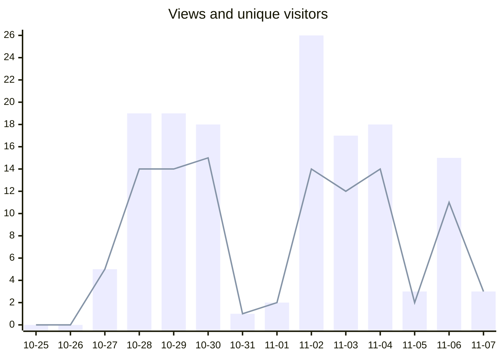

# Kalamu: statistics

Updated 2026-11-09 by the daily *Repository statistics* workflow (`.github/workflows/stats.yml` on the default branch). The figures are kept in [`data/`](data/) as CSV files, one row per day, for a spreadsheet or a dashboard.

| Downloads, versions | Downloads, all releases | Views, last 14 days |
| ---: | ---: | ---: |
| 226 | 278 | 146 |

## Downloads per version

Every file of a release counts once each time it is downloaded from GitHub. "…" means the history does not go back that far yet.

| Release | Published | Downloads | Last 7 days | Last 30 days |
| --- | --- | ---: | ---: | ---: |
| [v1.5.0](https://github.com/fmadore/Kalamu/releases/tag/v1.5.0) | 2026-11-07 | 8 | 8 | 8 |
| [v1.4.1](https://github.com/fmadore/Kalamu/releases/tag/v1.4.1) | 2026-11-05 | 10 | 10 | 10 |
| [v1.4.0](https://github.com/fmadore/Kalamu/releases/tag/v1.4.0) | 2026-11-04 | 8 | 8 | 8 |
| [v1.3.0](https://github.com/fmadore/Kalamu/releases/tag/v1.3.0) | 2026-11-03 | 24 | 24 | 24 |
| [v1.2.0](https://github.com/fmadore/Kalamu/releases/tag/v1.2.0) | 2026-11-03 | 40 | 40 | 40 |
| [v1.1.2](https://github.com/fmadore/Kalamu/releases/tag/v1.1.2) | 2026-11-02 | 35 | … | 35 |
| [v1.1.1](https://github.com/fmadore/Kalamu/releases/tag/v1.1.1) | 2026-11-02 | 12 | … | 12 |
| [v1.1.0](https://github.com/fmadore/Kalamu/releases/tag/v1.1.0) | 2026-11-02 | 15 | … | 15 |
| [v1.0.0](https://github.com/fmadore/Kalamu/releases/tag/v1.0.0) | 2026-10-30 | 38 | … | 38 |
| [v0.4.0](https://github.com/fmadore/Kalamu/releases/tag/v0.4.0) (pre-release) | 2026-10-29 | 15 | … | 15 |
| [v0.3.0](https://github.com/fmadore/Kalamu/releases/tag/v0.3.0) (pre-release) | 2026-10-28 | 11 | … | 11 |
| [v0.2.0](https://github.com/fmadore/Kalamu/releases/tag/v0.2.0) (pre-release) | 2026-10-25 | 5 | … | 5 |
| [v0.1.0](https://github.com/fmadore/Kalamu/releases/tag/v0.1.0) (pre-release) | 2026-10-25 | 5 | … | 5 |

Other releases (3): tools built for the app, not versions of it

| Release | Published | Downloads | Last 7 days | Last 30 days |
| --- | --- | ---: | ---: | ---: |
| [llama-b12110-1](https://github.com/fmadore/Kalamu/releases/tag/llama-b12110-1) (pre-release) | 2026-11-07 | 6 | 6 | 6 |
| [llama-b12110-3](https://github.com/fmadore/Kalamu/releases/tag/llama-b12110-3) (pre-release) | 2026-11-06 | 4 | 4 | 4 |
| [ffmpeg-9.0.2-1](https://github.com/fmadore/Kalamu/releases/tag/ffmpeg-9.0.2-1) (pre-release) | 2026-10-25 | 42 | … | 42 |

## Downloads per day, last 60 days

_Not enough days recorded yet for a chart._

## Files of v1.5.0

| File | Downloads |
| --- | ---: |
| Kalamu_1.5.0.msixbundle | 2 |
| Kalamu_1.5.0_aarch64.dmg | 1 |
| Kalamu_1.5.0_arm64-setup.exe | 1 |
| Kalamu_1.5.0_arm64.msix | 1 |
| Kalamu_1.5.0_x64-setup.exe | 1 |
| Kalamu_1.5.0_x64.msix | 1 |
| kalamu-samples.zip | 1 |

## Visits to the repository, last 60 days

Bars are views, the line unique visitors (GitHub's daily figures, UTC; today is still counting).

