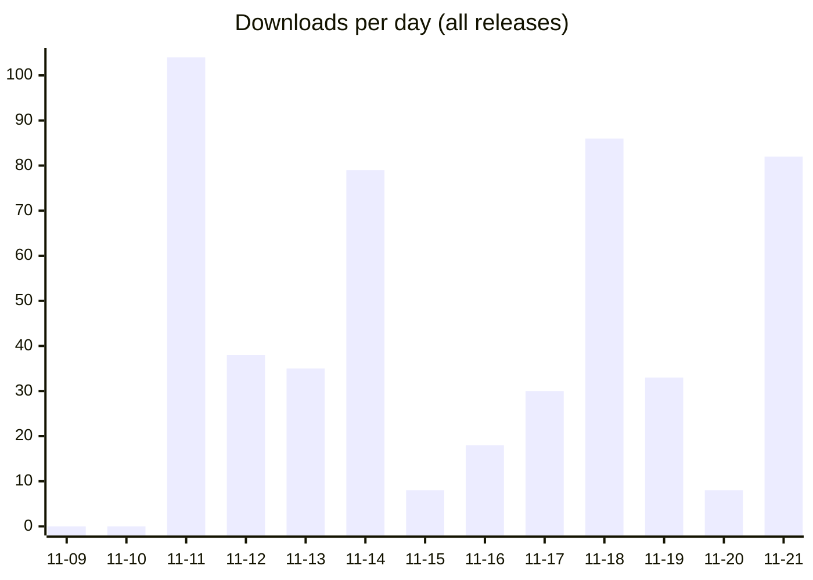
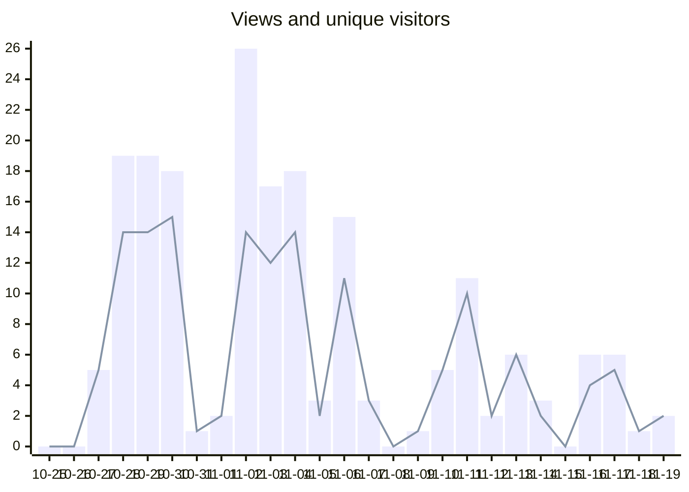

# Kalamu: statistics

Updated 2026-11-21 by the daily *Repository statistics* workflow (`.github/workflows/stats.yml` on the default branch). The figures are kept in [`data/`](data/) as CSV files, one row per day, for a spreadsheet or a dashboard.

| Downloads, versions | Downloads, all releases | Views, last 14 days |
| ---: | ---: | ---: |
| 402 | 799 | 43 |

## Downloads per version

Every file of a release counts once each time it is downloaded from GitHub. "…" means the history does not go back that far yet.

| Release | Published | Downloads | Last 7 days | Last 30 days |
| --- | --- | ---: | ---: | ---: |
| [v1.9.0](https://github.com/fmadore/Kalamu/releases/tag/v1.9.0) | 2026-11-20 | 18 | 18 | 18 |
| [v1.8.0](https://github.com/fmadore/Kalamu/releases/tag/v1.8.0) | 2026-11-17 | 31 | 31 | 31 |
| [v1.7.0](https://github.com/fmadore/Kalamu/releases/tag/v1.7.0) | 2026-11-13 | 32 | 23 | 32 |
| [v1.6.0](https://github.com/fmadore/Kalamu/releases/tag/v1.6.0) | 2026-11-10 | 38 | 14 | 38 |
| [v1.5.0](https://github.com/fmadore/Kalamu/releases/tag/v1.5.0) | 2026-11-07 | 36 | 11 | 36 |
| [v1.4.1](https://github.com/fmadore/Kalamu/releases/tag/v1.4.1) | 2026-11-05 | 28 | 0 | 28 |
| [v1.4.0](https://github.com/fmadore/Kalamu/releases/tag/v1.4.0) | 2026-11-04 | 19 | 0 | 19 |
| [v1.3.0](https://github.com/fmadore/Kalamu/releases/tag/v1.3.0) | 2026-11-03 | 24 | 0 | 24 |
| [v1.2.0](https://github.com/fmadore/Kalamu/releases/tag/v1.2.0) | 2026-11-03 | 40 | 0 | 40 |
| [v1.1.2](https://github.com/fmadore/Kalamu/releases/tag/v1.1.2) | 2026-11-02 | 35 | 0 | 35 |
| [v1.1.1](https://github.com/fmadore/Kalamu/releases/tag/v1.1.1) | 2026-11-02 | 12 | 0 | 12 |
| [v1.1.0](https://github.com/fmadore/Kalamu/releases/tag/v1.1.0) | 2026-11-02 | 15 | 0 | 15 |
| [v1.0.0](https://github.com/fmadore/Kalamu/releases/tag/v1.0.0) | 2026-10-30 | 38 | 0 | 38 |
| [v0.4.0](https://github.com/fmadore/Kalamu/releases/tag/v0.4.0) (pre-release) | 2026-10-29 | 15 | 0 | 15 |
| [v0.3.0](https://github.com/fmadore/Kalamu/releases/tag/v0.3.0) (pre-release) | 2026-10-28 | 11 | 0 | 11 |
| [v0.2.0](https://github.com/fmadore/Kalamu/releases/tag/v0.2.0) (pre-release) | 2026-10-25 | 5 | 0 | 5 |
| [v0.1.0](https://github.com/fmadore/Kalamu/releases/tag/v0.1.0) (pre-release) | 2026-10-25 | 5 | 0 | 5 |

Other releases (5): tools built for the app, not versions of it

| Release | Published | Downloads | Last 7 days | Last 30 days |
| --- | --- | ---: | ---: | ---: |
| [llama-b12110-2](https://github.com/fmadore/Kalamu/releases/tag/llama-b12110-2) (pre-release) | 2026-11-18 | 55 | 55 | 55 |
| [ffmpeg-9.0.2-2](https://github.com/fmadore/Kalamu/releases/tag/ffmpeg-9.0.2-2) (pre-release) | 2026-11-13 | 78 | 57 | 78 |
| [llama-b12110-1](https://github.com/fmadore/Kalamu/releases/tag/llama-b12110-1) (pre-release) | 2026-11-07 | 165 | 56 | 165 |
| [llama-b12110-3](https://github.com/fmadore/Kalamu/releases/tag/llama-b12110-3) (pre-release) | 2026-11-06 | 22 | 0 | 22 |
| [ffmpeg-9.0.2-1](https://github.com/fmadore/Kalamu/releases/tag/ffmpeg-9.0.2-1) (pre-release) | 2026-10-25 | 77 | 0 | 77 |

## Downloads per day, last 60 days

## Files of v1.9.0

| File | Downloads |
| --- | ---: |
| kalamu-samples.zip | 5 |
| Kalamu_1.9.0_aarch64.dmg | 3 |
| Kalamu_1.9.0_arm64-setup.exe | 3 |
| Kalamu_1.9.0_x64-setup.exe | 3 |
| Kalamu_1.9.0_arm64.msix | 1 |
| Kalamu_1.9.0_x64.msix | 1 |
| Kalamu_1.9.0.msixbundle | 1 |
| SHA256SUMS | 1 |

## Visits to the repository, last 60 days

Bars are views, the line unique visitors (GitHub's daily figures, UTC; today is still counting).

