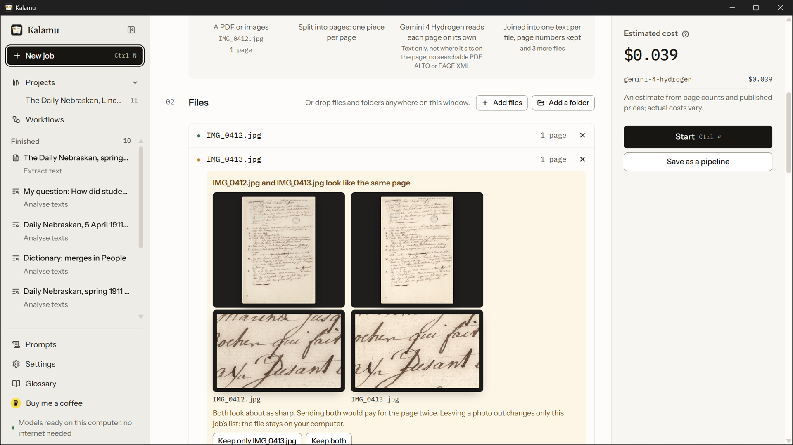
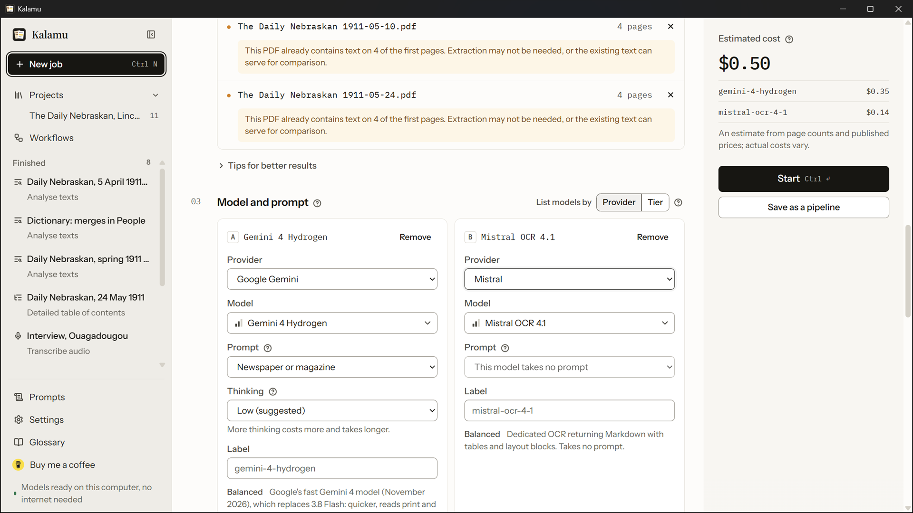
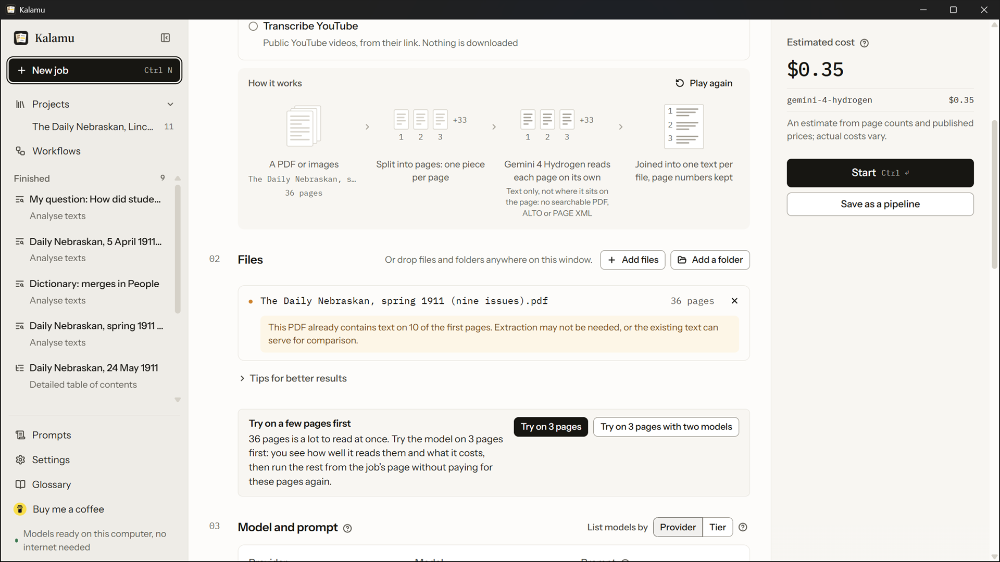
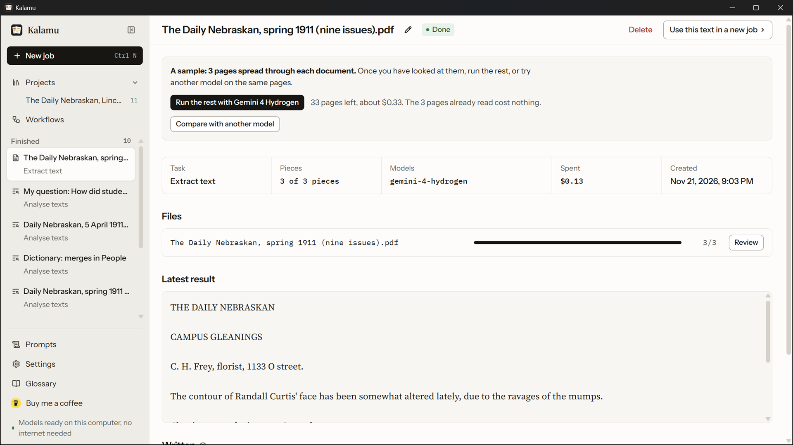

[Français](fr/first-job.md)

Start small. Take three or four pages that are typical of your material, not the cleanest ones:
a first job is there to show you how well a model reads *your* documents and what it costs.

## 1. Choose the task and the files

Open **New job** (<kbd>Ctrl</kbd> <kbd>N</kbd>, or <kbd>⌘</kbd> <kbd>N</kbd> on a Mac) and choose
**Extract text**. Add a PDF or some images (JPEG, PNG, TIFF) by choosing them or dropping them
on the window. A folder of photographed pages can be read as one document, its pages in the
order of their names.

Kalamu inspects your files before sending anything and warns you about issues that could spoil
the reading: two pages photographed as one spread, very low resolution, or a skewed page. Each
warning comes with a suggested fix you can accept, and your original files are never modified.

For photographs, Kalamu also compares images locally and flags when two look like duplicate
shots of the same page, or when one appears blurred. It displays them side by side and suggests
the sharper image; nothing is excluded unless you choose it, and the file stays untouched on
disk. If you exclude a photo by mistake, click **Undo** in the confirmation banner or press
<kbd>Ctrl</kbd> <kbd>Z</kbd> (<kbd>⌘</kbd> <kbd>Z</kbd> on a Mac) while the banner is visible
(hovering over it keeps it open). Every banner with **Undo** works the same way.

*The same page photographed twice: Kalamu shows both and lets you keep one, or both.*

*New job: the files, the model, the prompt and what it should cost, before anything is sent.*

## 2. Choose a model and a prompt

- **The model** does the reading. The list shows the models your keys can use and the offline
  ones you have downloaded, with their prices. A smaller model is the sensible first try; move
  up only if the result is not good enough.
- **The prompt** is the instruction the model follows. Kalamu ships prompts for common
  material (printed text, handwriting, newspapers in columns and so on). Pick the closest one;
  you can read it, and later copy and adapt it under **Prompts**.
- **The languages** of the document, if you know them, help with names and old spellings.

## 3. Check the estimate and start

At the bottom, **Estimated cost** is worked out from the number of pages and the provider's
published prices. It is an estimate; the provider's invoice is what counts, and it is usually
close. Press **Start**.

The job appears in the sidebar under *Running*, page by page. You can keep working, start
another job, or close the app: what is done is saved, and the job resumes when you come back.

## 4. Check the text against the scan

When the job ends it moves to *For you to check*. Open it: the scan is on the left, the text on
the right.

- Read a few pages properly, looking at names, numbers and dates first. Those are where models
  go wrong most often and where it matters most.
- To fix an error, edit the text directly in place. Your correction is stored separately from
  the model's output, which stays preserved underneath.
- **Mark as reviewed** when a page is right. The job shows how many pages you have reviewed.
- <kbd>Ctrl</kbd> <kbd>F</kbd> (<kbd>⌘</kbd> <kbd>F</kbd>) searches the whole document.

[Checking results](review.md) covers the review in detail, including the best way to find
errors quickly: reading the same pages with two models and looking only at where they differ.

## 5. Export

Kalamu writes the text in the formats you ticked under **Results** in New job, beside your
originals or in a folder you chose, and writes them again after your corrections: plain text,
Markdown, Word, an Excel spreadsheet, JSON, CSV, a searchable PDF, or ALTO and PAGE XML with each word's place on the page. Every export comes
with a `provenance.json` that records the model, the prompt and the settings, so you can cite
exactly how the text was made. See [Exporting and citing](export.md).

The files are named after the original: `letter.txt` for `letter.pdf`. When another job you
kept already writes files for the same original, the new job's files carry its model's name
as well, `letter.lightonocr-3-1b.txt`, as a comparison's do, so neither replaces the other.

## What to do next

- For long documents, Kalamu helps you test first: when a PDF has more than 15 pages, New job
  offers **Try on 3 pages**, sampled from across the document. On the resulting job page,
  **Run the rest** reads the remaining pages without paying for those three again, and
  **Compare with another model** runs the same three pages through a second model.
- If the reading is good: run the rest of the collection, and consider the
  [cheaper mode](costs.md), which costs half for an answer within a day.
- If it is not: try another prompt or a stronger model on the same pages. Because results are
  cached, only what changes is paid for.
- Put the documents in a [project](projects.md) to keep every reading of them together.

*A long PDF: New job offers to try the model on 3 pages first.*

*The sample's page: run the rest, or compare the same three pages with another model.*
