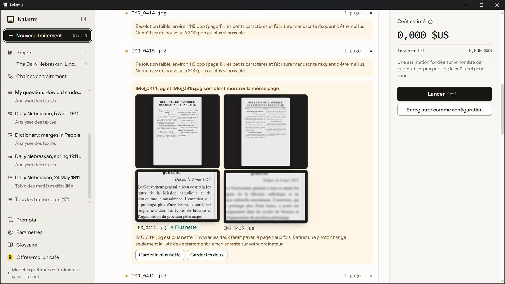
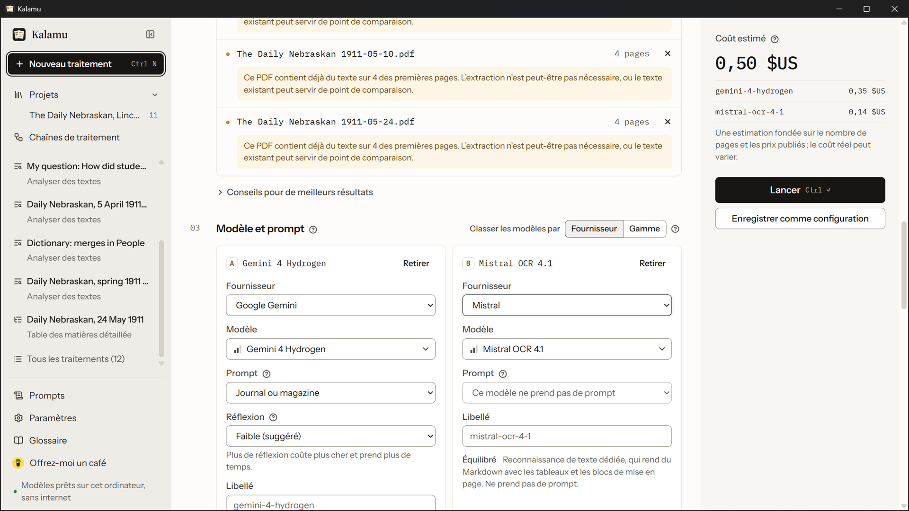
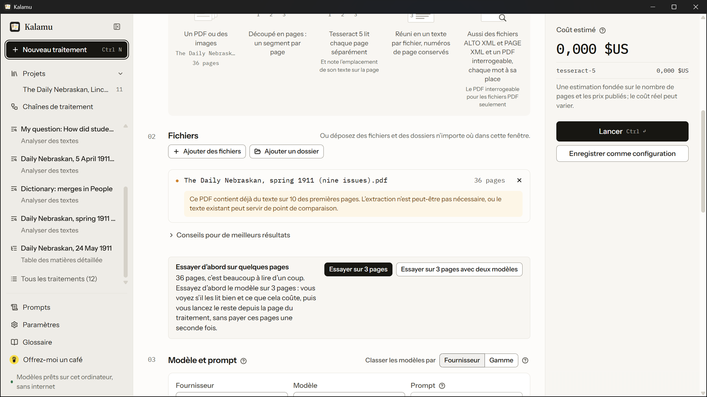
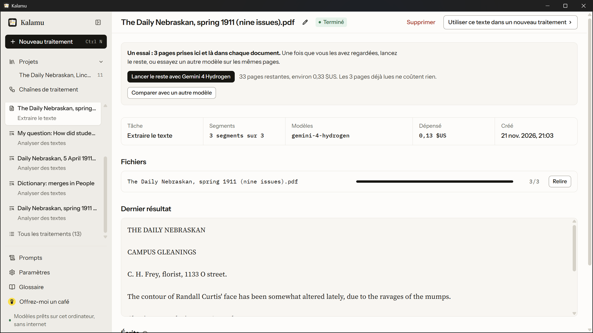

[English](../first-job.md)

Commencez petit. Prenez trois ou quatre pages représentatives de vos documents, pas les plus
propres : un premier traitement sert à voir si un modèle lit bien *vos* documents, et ce que
cela coûte.

## 1. Choisir la tâche et les fichiers

Ouvrez **Nouveau traitement** (<kbd>Ctrl</kbd> <kbd>N</kbd>, ou <kbd>⌘</kbd> <kbd>N</kbd> sur un
Mac) et choisissez **Extraire le texte**. Ajoutez un PDF ou des images (JPEG, PNG, TIFF) : vous
pouvez les choisir dans une fenêtre ou les faire glisser sur celle de Kalamu. Un dossier de pages
photographiées peut être lu comme un seul document, les pages étant prises dans l’ordre de leurs
noms.

Avant d’envoyer quoi que ce soit, Kalamu examine les fichiers et vous signale ce qui pourrait
gêner la lecture : deux pages photographiées ensemble en double page, une résolution très
faible, une page penchée. Chaque avertissement propose une correction, que vous pouvez accepter.
Vos fichiers d’origine ne sont jamais modifiés.

Avec des photos, Kalamu les compare aussi entre elles sur votre ordinateur et vous prévient
quand deux semblent montrer la même page prise deux fois, ou quand l’une semble floue. Il les
montre côte à côte et propose la plus nette : rien n’est retiré sans votre choix, et le
fichier reste où il est. Une photo retirée revient avec **Annuler** dans le message qui le
dit, ou avec <kbd>Ctrl</kbd> <kbd>Z</kbd> (<kbd>⌘</kbd> <kbd>Z</kbd> sur un Mac) tant que le
message est affiché ; il reste tant que la souris est dessus. Tous les messages qui
proposent **Annuler** font de même.

*La même page photographiée deux fois : Kalamu montre les deux et vous laisse en garder une, ou les deux.*

*Nouveau traitement : les fichiers, le modèle, le prompt et ce que cela devrait coûter, avant tout envoi.*

## 2. Choisir un modèle et un prompt

- **Le modèle** fait la lecture. La liste montre les modèles auxquels vos clés donnent accès et
  les modèles hors ligne que vous avez téléchargés, avec leurs prix. Il est raisonnable
  d’essayer d’abord un petit modèle, et de passer à un plus puissant seulement si le résultat ne
  suffit pas.
- **Le prompt** est la consigne que suit le modèle. Kalamu fournit des prompts pour les
  documents courants (texte imprimé, écriture manuscrite, journaux en colonnes, etc.). Prenez le
  plus proche de vos documents. Vous pouvez le lire, puis plus tard le copier et l’adapter dans
  **Prompts**.
- **Les langues** du document, si vous les connaissez, aident le modèle pour les noms et les
  orthographes anciennes.

## 3. Vérifier l’estimation et lancer

En bas, le **Coût estimé** est calculé à partir du nombre de pages et des prix publiés par le
fournisseur. C’est une estimation : seule la facture du fournisseur fait foi, et elle en est
généralement proche. Cliquez sur **Lancer**.

Le traitement apparaît dans la barre latérale, sous *En cours*, et avance page par page. Vous
pouvez continuer à travailler, lancer un autre traitement ou fermer l’application : ce qui est
fait est enregistré, et le traitement reprend à votre retour.

## 4. Vérifier le texte face au scan

Une fois terminé, le traitement passe sous *À vérifier*. Ouvrez-le : le scan est à gauche, le
texte à droite.

- Lisez vraiment quelques pages, en regardant d’abord les noms, les chiffres et les dates. C’est
  là que les modèles se trompent le plus souvent, et là que les erreurs comptent le plus.
- Pour corriger, modifiez le texte directement. Votre correction est gardée à côté de ce que le
  modèle a écrit, qui reste consultable.
- Cliquez sur **Marquer comme relu** quand une page est juste. Le traitement indique combien de
  pages vous avez relues.
- <kbd>Ctrl</kbd> <kbd>F</kbd> (<kbd>⌘</kbd> <kbd>F</kbd>) cherche dans tout le document.

Le chapitre [Vérifier les résultats](review.md) présente la relecture en détail, y compris le
moyen le plus rapide de trouver les erreurs : faire lire les mêmes pages par deux modèles et ne
regarder que les endroits où ils diffèrent.

## 5. Exporter

Kalamu écrit le texte dans les formats que vous avez cochés sous **Résultats** dans Nouveau
traitement, à côté de vos originaux ou dans un dossier de votre choix, et les écrit à nouveau
après vos corrections : texte brut, Markdown, Word, tableur Excel, JSON, CSV, PDF interrogeable, ou ALTO et PAGE XML avec la place de chaque mot sur la page. Chaque export
s’accompagne d’un fichier `provenance.json` qui indique le modèle, le prompt et les réglages :
vous pouvez ainsi citer exactement la façon dont le texte a été produit. Voir
[Exporter et citer](export.md).

Les fichiers portent le nom de l’original : `lettre.txt` pour `lettre.pdf`. Quand un autre
traitement que vous avez gardé écrit déjà des fichiers pour le même original, ceux du nouveau
traitement portent aussi le nom de son modèle, `lettre.lightonocr-3-1b.txt`, comme ceux d’une
comparaison, et aucun ne remplace l’autre.

## Et ensuite ?

- Pour un long document, Kalamu fait ce premier essai pour vous : quand un PDF a plus de
  15 pages, Nouveau traitement propose **Essayer sur 3 pages**, prises ici et là dans le
  document. Sur la page de ce traitement, **Lancer le reste** lit les autres pages sans faire
  payer ces trois-là une seconde fois, et **Comparer avec un autre modèle** fait lire les
  trois mêmes pages par un second modèle.
- Si la lecture est bonne : lancez le reste de la collection, et pensez au
  [mode moins cher](costs.md), qui coûte moitié moins si vous acceptez une réponse dans la
  journée.
- Sinon : essayez un autre prompt ou un modèle plus puissant sur les mêmes pages. Comme les
  résultats sont gardés en mémoire, vous ne payez que ce qui change.
- Rangez les documents dans un [projet](projects.md) pour garder ensemble tout ce qui en a été
  lu.

*Un long PDF : Nouveau traitement propose d’essayer le modèle sur 3 pages d’abord.*

*La page de l’essai : lancer le reste, ou faire lire les trois mêmes pages par un autre modèle.*
