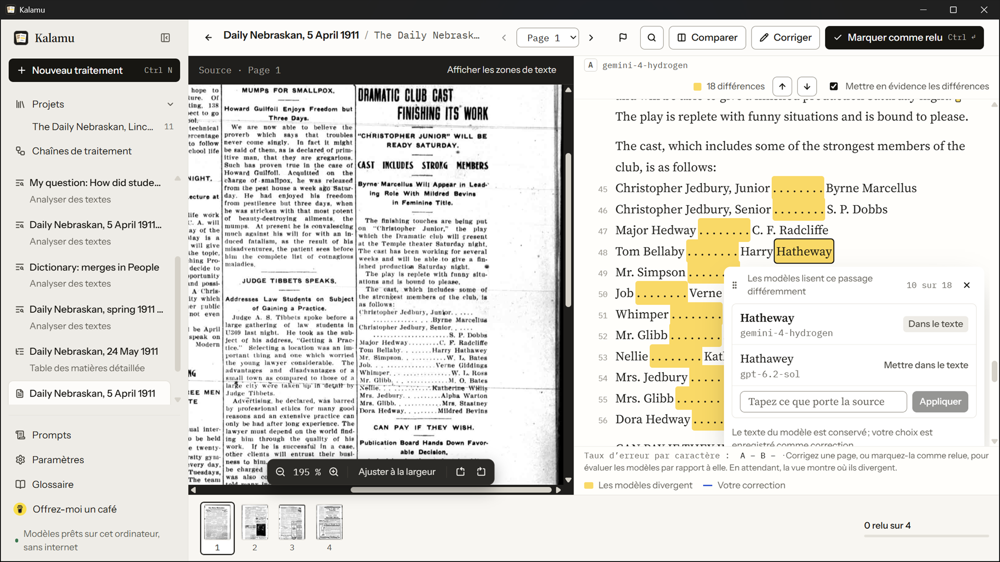

[English](../index.md)

Ce guide vous accompagne de l’installation de Kalamu jusqu’à l’export de résultats que vous avez
vérifiés. Chaque chapitre se lit seul. Si vous débutez, lisez celui-ci, puis
[Votre premier traitement](first-job.md).

*La relecture : la source à gauche, le texte à côté, et en jaune ce que deux modèles ont lu différemment.*

## Ce qu’il vous faut

- **Un ordinateur** : un PC sous Windows 11 (Intel, AMD ou Snapdragon), ou un Mac avec une puce
  Apple et macOS 14 ou plus récent.
- **De quoi faire la lecture**, au choix :
  - une **clé d’API** de Google (Gemini), OpenAI, Anthropic (Claude) ou Mistral. Vous payez le
    fournisseur pour ce que vous utilisez, en général quelques centimes pour un premier
    traitement. Kalamu lui-même est gratuit et ne prend rien ;
  - ou un **modèle hors ligne**, téléchargé une fois pour toutes dans l’application : Whisper pour
    les enregistrements, Tesseract pour l’imprimé net, de petits modèles pour les pages plus
    difficiles et pour les analyses. Rien n’est envoyé et rien n’est facturé, mais ces modèles
    sont plus lents et moins bons que les modèles en ligne. Voir
    [Travailler hors ligne](offline.md).

Pas besoin de Python, ni de ligne de commande, ni de compte chez Kalamu.

## Installer Kalamu

**Windows.** Installez Kalamu depuis le
[Microsoft Store](https://apps.microsoft.com/detail/9MXT5555BZ1H), qui le tient à jour. Vous
pouvez aussi télécharger le programme d’installation sur la
[page des versions](https://github.com/fmadore/Kalamu/releases) :
`Kalamu_<version>_x64-setup.exe` pour les PC Intel et AMD, `Kalamu_<version>_arm64-setup.exe`
pour les portables Snapdragon. Ces deux fichiers ne sont pas signés : la première fois, Windows
SmartScreen affiche un avertissement. Choisissez **Informations complémentaires**, puis
**Exécuter quand même**.

**macOS.** Téléchargez `Kalamu_<version>_aarch64.dmg` sur la
[page des versions](https://github.com/fmadore/Kalamu/releases), ouvrez-le et faites glisser
Kalamu dans le dossier Applications. L’application est signée et vérifiée par Apple : macOS
l’ouvre après sa question habituelle sur les applications téléchargées sur Internet.

## Le premier lancement

À sa première ouverture, sans clé enregistrée ni rien d’installé sur l’ordinateur, Kalamu
s’ouvre sur **Paramètres**, avec **Bienvenue dans Kalamu**. Deux façons de commencer vous sont
proposées, et vous pourrez ajouter l’autre plus tard :

- **Utiliser un modèle sur cet ordinateur** : gratuit, sans compte, et rien ne quitte votre
  ordinateur. Le modèle est téléchargé une fois ; il est plus lent qu’un modèle en ligne. Voir
  [Travailler hors ligne](offline.md).
- **Ajouter la clé d’un service en ligne** : plus rapide et souvent plus juste. Vous ouvrez un
  compte chez le fournisseur, qui facture ce que vous utilisez, et vos fichiers lui sont
  envoyés. Voir ci-dessous.

Dès que l’un ou l’autre est en place, Kalamu ne s’ouvre plus sur Paramètres. **Lire le guide**,
dans l’accueil, le Glossaire et Paramètres › À propos, ouvre ce guide dans la langue de
l’interface.

## Ajouter une clé d’API

1. Ouvrez **Paramètres** (<kbd>Ctrl</kbd> <kbd>,</kbd> sous Windows, <kbd>⌘</kbd> <kbd>,</kbd>
   sur un Mac), puis **Clés d’API**.
2. À côté du fournisseur choisi, **Obtenir une clé** ouvre la page du fournisseur, où vous créez
   la clé. Copiez-la.
3. Collez-la dans Kalamu, cliquez sur **Enregistrer**, puis sur **Tester** : Kalamu répond en
   indiquant le nombre de modèles auxquels la clé donne accès.

La clé est gardée dans le Gestionnaire d’identification de Windows ou dans le Trousseau de
macOS, jamais dans un fichier de Kalamu, et elle n’est envoyée qu’à son fournisseur. Vos fichiers
vont directement de votre ordinateur à ce fournisseur. Ils ne passent jamais par un serveur de
Kalamu, car il n’y en a pas.

> **Quel fournisseur choisir ?** Tous lisent bien l’imprimé et l’écriture manuscrite. Si vous
> n’avez pas de préférence, commencez par celui avec lequel votre établissement a déjà un accord,
> ou par Gemini, dont les petits modèles coûtent assez peu pour faire des essais sans compter.
> Vous pouvez ajouter plusieurs clés et [comparer des modèles](review.md#comparer-des-modeles)
> sur vos propres documents : vous en apprendrez plus qu’avec n’importe quel classement.

## Se repérer dans l’application

Tout se trouve dans la barre latérale, à gauche :

| Où | À quoi ça sert |
| --- | --- |
| **Nouveau traitement** | Choisir les fichiers, un modèle et un prompt, voir le coût estimé, et lancer. |
| **Projets** | Vos documents regroupés par projet de recherche, avec tout ce qui en a été lu, une recherche, un dictionnaire des noms et la liste de ce qui reste à vérifier. |
| **Chaînes de traitement** | Plusieurs étapes à la suite : lire le texte, le vérifier, puis l’analyser. |
| **Traitements** | Tous les traitements que vous avez lancés, pour les retrouver, les trier, les renommer ou les supprimer. |
| **Prompts** | Les consignes données aux modèles : celles que fournit Kalamu et les vôtres. |
| **Paramètres** | Les clés d’API, les modèles hors ligne, la langue et l’apparence. |
| **Glossaire** | Des explications simples des mots qu’emploient ces outils, de l’OCR à l’hallucination. |

En dessous, la barre latérale liste vos traitements : en cours, inachevés, à vérifier et
terminés. Un traitement mis en pause, ou interrompu parce que l’application a été fermée,
apparaît en bas de la barre latérale avec un bouton **Reprendre**.

## Trois choses à savoir avant de commencer

- **Une IA peut écrire un texte fluide et faux.** Un modèle peut sauter une ligne, moderniser une
  orthographe ou écrire un nom qui n’est pas sur la page, et il le fera avec la même assurance.
  Kalamu est conçu pour la vérification : comparez toujours quelques pages avec la source avant
  de vous fier à un résultat.
- **Ce que le modèle a écrit n’est jamais effacé.** Vos corrections sont gardées à côté, et chaque
  export indique quel modèle, quel prompt et quels réglages ont produit le texte.
- **Vous ne payez jamais deux fois le même travail.** Les résultats sont enregistrés page par
  page. Un traitement interrompu reprend là où il s’était arrêté, et redemander la même chose
  avec les mêmes réglages ne coûte rien.
