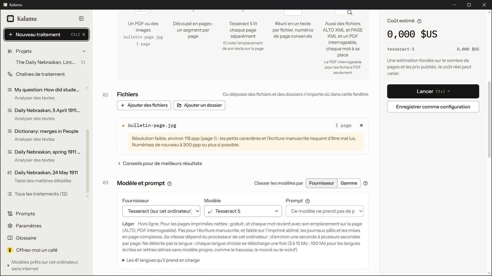

[English](../offline.md)

*Paramètres › Modèles hors ligne : téléchargez ce dont vous avez besoin, retirez ce qui ne vous sert plus.*

## Ce qui fonctionne hors ligne

| Pour | Modèle | À quoi s’attendre |
| --- | --- | --- |
| Les enregistrements | **Whisper**, en plusieurs tailles | Une bonne transcription dans de nombreuses langues. Les grandes tailles sont plus justes et plus lentes. |
| L’imprimé net | **Tesseract** | Rapide, gratuit, chaque mot avec sa place sur la page. Les données se téléchargent langue par langue. Ne lit pas l’écriture manuscrite. |
| L’imprimé abîmé, les colonnes, les tableaux | **LightOnOCR-3**, **GLM-OCR** | De petits modèles de vision. Bien meilleurs que Tesseract sur les pages difficiles, mais bien plus lents sur le processeur. Comme tout modèle de langue, ils peuvent écrire du texte qui n’est pas sur la page. |
| La recherche par le sens | **EmbeddingGemma 2** | Un petit modèle (310 Mo) qui prépare le texte d’un projet pour [la recherche par le sens et la carte](projects.md#la-recherche-par-le-sens-et-la-carte). |
| Les analyses, les tables des matières, la correction | **Gemma 4** (E4B et E2B) | De petits modèles de langue. Bien moins bons que les modèles en ligne : vérifiez leurs réponses. |

Rien n’est envoyé nulle part et rien n’est facturé. Le prix à payer, c’est le temps, et pour les
modèles de langue, la qualité.

## Télécharger un modèle

Ouvrez **Paramètres**, puis **Modèles hors ligne**. Chaque modèle indique sa taille ;
**Télécharger** le récupère une fois pour toutes, et un téléchargement interrompu reprend là où il
s’était arrêté. Avant de se servir d’un fichier, Kalamu vérifie qu’il correspond à l’empreinte
publiée. Retirez un modèle au même endroit quand vous n’en avez plus besoin.

Une fois téléchargés, les modèles hors ligne apparaissent dans **Nouveau traitement**, à côté des
modèles en ligne.

## À quelle vitesse ? {#a-quelle-vitesse}

Cela dépend de votre ordinateur, et surtout de son processeur graphique.

- **Sur un Mac avec une puce Apple**, les modèles hors ligne utilisent le processeur graphique
  (Metal) et donnent le meilleur d’eux-mêmes.
- **Sous Windows**, Whisper et les modèles de vision et de langue passent par la carte graphique
  avec Vulkan quand le PC en a une utilisable. Sinon, ils tournent sur le processeur, ce qui est
  plus lent, parfois beaucoup plus pour les modèles de vision et de langue.
- Tesseract tourne toujours sur le processeur, et il est rapide partout.

Essayez d’abord un enregistrement ou quelques pages pour voir ce que votre ordinateur peut faire,
puis laissez tourner un long traitement : vous pouvez le mettre en pause, et il reprend là où il
s’était arrêté.

## Quand préférer un modèle en ligne

L’écriture manuscrite, les documents abîmés, les enregistrements avec beaucoup de locuteurs et
toute analyse qui demande du discernement donnent nettement de meilleurs résultats avec les
grands modèles en ligne. Si vos sources le permettent, une bonne façon de faire est de réaliser
la première lecture hors ligne quand elle suffit (imprimé net, enregistrements clairs), et de
garder les modèles en ligne pour ce qui en a besoin. Si vos sources ne le permettent pas, restez
hors ligne et relisez davantage.

Quoi que vous utilisiez, Kalamu le note : le fichier `provenance.json` d’un export indique quel
modèle a lu le texte, en ligne ou hors ligne.
