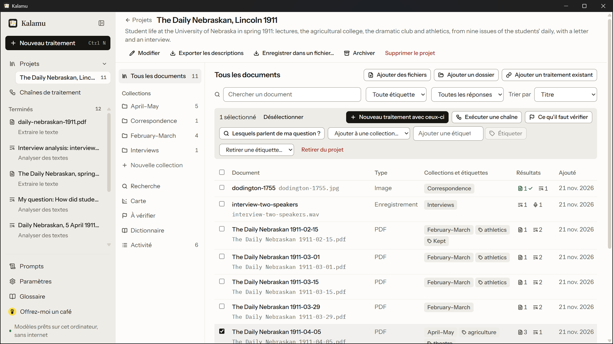
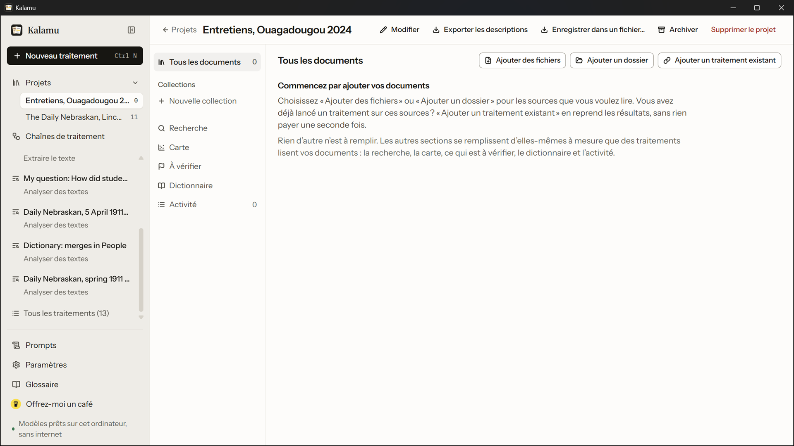
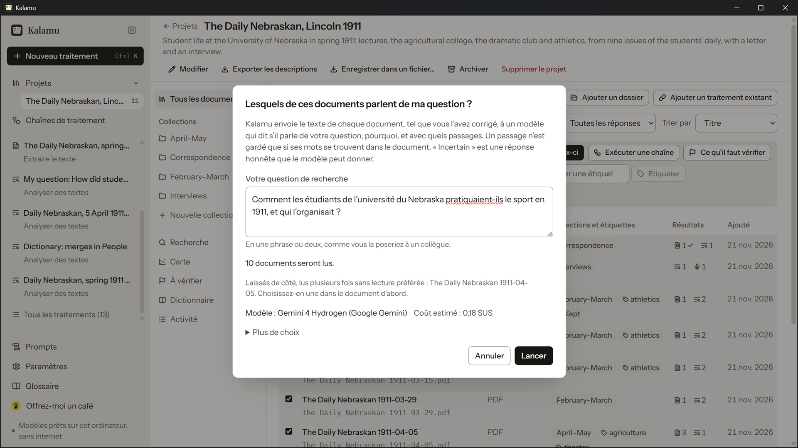
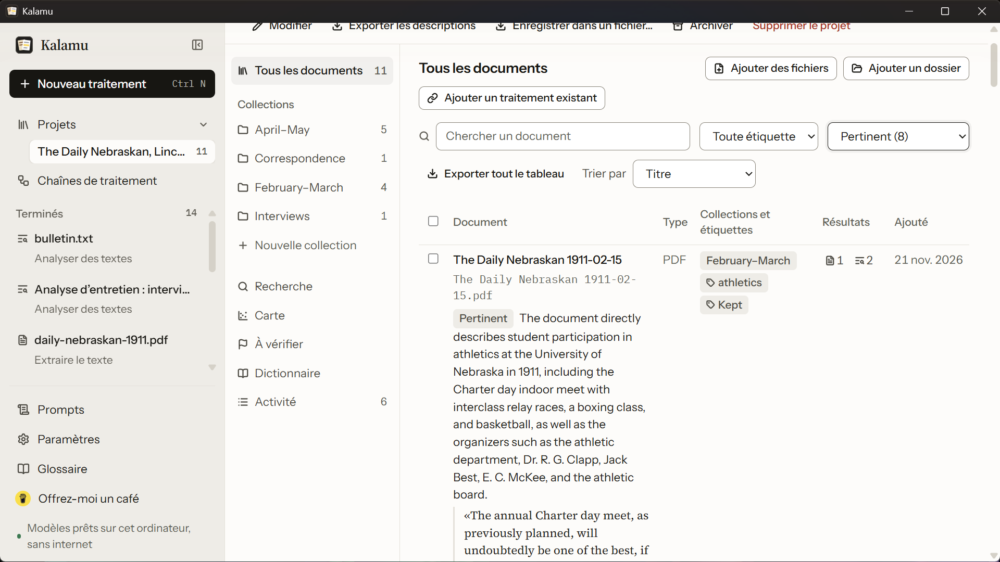
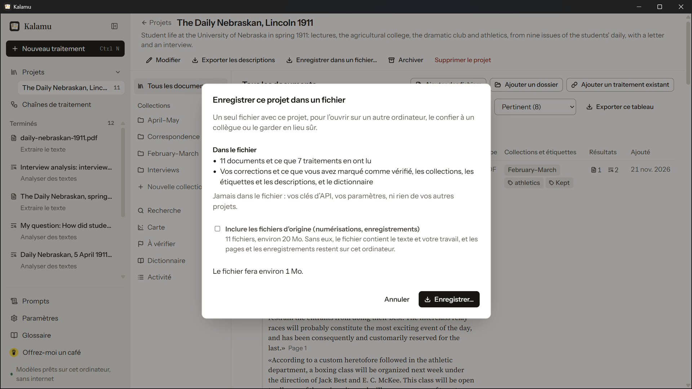
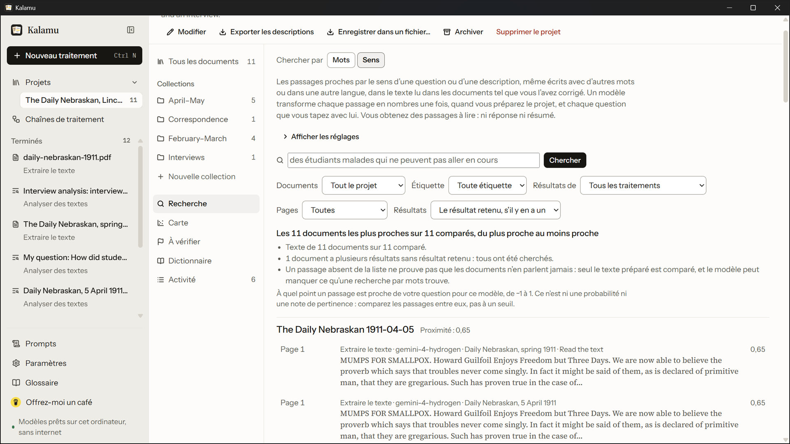
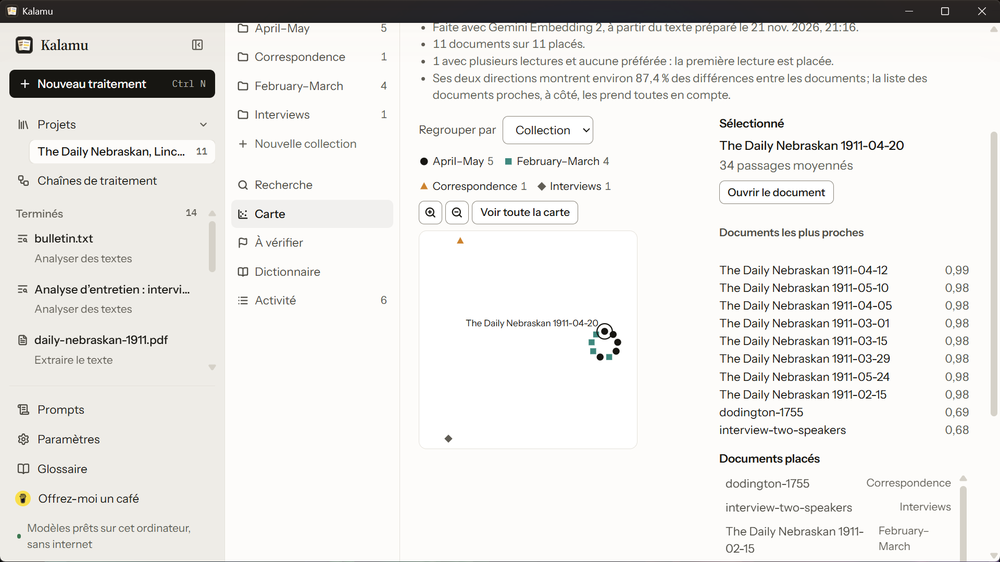
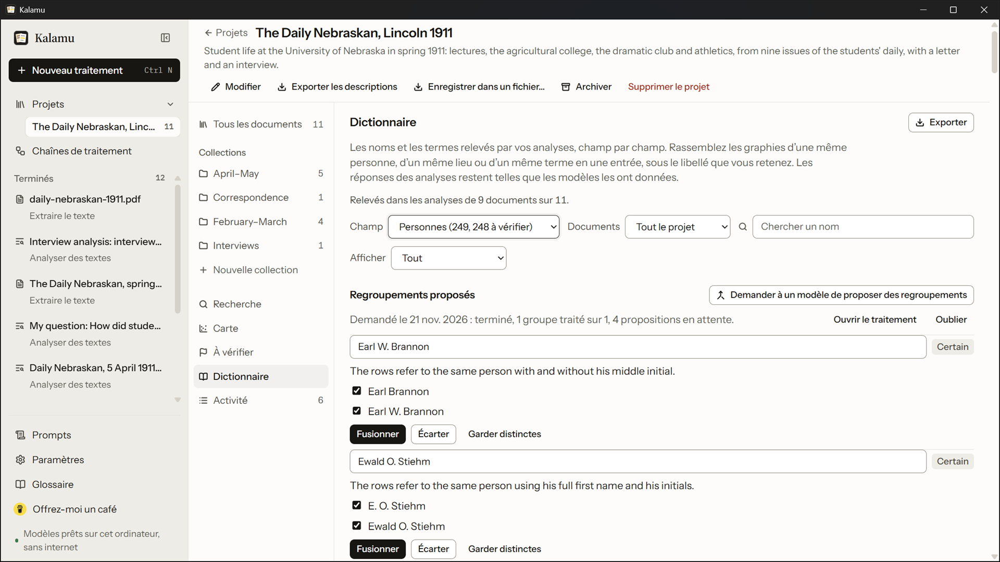

[English](../projects.md)

*Les documents d’un projet, chacun avec ses extractions, ses transcriptions et ses analyses.*

## Documents et collections

Un projet contient des **documents**. Un document, c’est une source (un PDF, un dossier de
photographies, un enregistrement) avec toutes les transcriptions, extractions et analyses qui en
ont été faites.

*Un nouveau projet commence par demander ses documents  les autres sections se remplissent seules.*

- Ajoutez des fichiers avant de les faire lire (**Ajouter des fichiers**), ou des traitements
  que vous avez déjà lancés (**Ajouter un traitement existant**) : rien n’est payé une seconde
  fois. Vous pouvez aussi faire glisser un traitement terminé de la barre latérale sur un projet.
- Rangez les documents dans des **collections** ; un même document peut être dans plusieurs. Les
  **étiquettes**, elles, valent pour toutes les collections.
- **Lancez un traitement sur une sélection** : cochez quelques documents et lancez sur eux une
  extraction, une analyse ou une chaîne de traitement.
- **Demandez quels documents parlent de votre question** : cochez des documents déjà lus,
  choisissez **Lesquels parlent de ma question ?** et écrivez votre question de recherche.
  Fermée sans lancer le traitement, la fenêtre garde votre question jusqu’à sa prochaine
  ouverture.
  Chaque document revient avec une réponse (pertinent, en partie, non pertinent ou incertain),
  une raison et les passages qui le montrent, chacun retrouvé mot pour mot dans le texte avec
  sa page. Filtrez le tableau selon la réponse, lisez les passages, puis choisissez **Garder**
  ou **Écarter** : votre décision est une étiquette, et la réponse du modèle reste telle
  quelle. L’étiquette est écrite dans la langue de l’interface (*Gardé* ou *Écarté* en
  français, *Kept* ou *Set aside* en anglais), et votre décision tient quelle que soit la
  langue : après un changement dans les Paramètres, ou quand une collègue qui travaille dans
  l’autre langue ouvre votre fichier de projet. Un document étiqueté des deux façons affiche
  **Gardé et écarté : à trancher** à côté des boutons ; **Garder** ou **Écarter** tranche et ne
  laisse qu’une étiquette. **Exporter tout le tableau** écrit toute la liste pour un tableur ;
  ses colonnes `job_id` et `prompt_fingerprint` disent quel traitement a donné chaque réponse et
  avec quelle version du prompt elle a été lue. Quand une réponse est choisie dans le filtre,
  chaque ligne montre sa réponse, la raison et les passages. Si vous ajoutez des documents plus
  tard, **Poser cette question aux nouveaux documents** ne fait lire que ceux-là. Si le prompt
  a été modifié depuis la première fois, la fenêtre le dit : les nouvelles réponses sont rangées
  à part des précédentes, et le filtre montre la question deux fois, chacune suivie de « posée
  la première fois le » et de la date.
- Quand un document a été lu plusieurs fois, choisissez le résultat auquel vous vous fiez avec
  **Retenir**. La recherche, les exports et les analyses utilisent alors celui-là.

*Lesquels parlent de ma question  La question, le nombre de documents à lire, et ce que cela devrait coûter.*

*Les réponses dans le tableau  la réponse de chaque document, sa raison, et les passages retrouvés dans son texte.*

## Enregistrer un projet dans un fichier

**Enregistrer dans un fichier…** écrit tout le projet dans un seul fichier qui finit par
`.kalamu` : pour l’ouvrir sur un nouvel ordinateur, le confier à un collègue qui vérifie avec
vous, ou en garder une copie en lieu sûr. Le fichier contient le texte lu dans vos documents,
vos corrections, ce que vous avez marqué comme vérifié, les étiquettes, les descriptions et le
dictionnaire. Il ne contient jamais vos clés d’API. Vos numérisations et vos enregistrements
n’y sont pas, sauf si vous cochez **Inclure les fichiers d’origine** ; Kalamu indique la
taille du fichier avant de l’écrire.

*Ce qui entre dans un fichier de projet, et ce qui n’y entre jamais.*

Avant de terminer le fichier, Kalamu vérifie chaque fichier qu’il y met en le comparant à
l’empreinte prise au moment de sa lecture. Quand une analyse, une traduction ou une correction
a lu le texte corrigé d’un résultat précédent, Kalamu a gardé ce texte tel qu’il était alors ;
si l’un de ces textes ne se trouve plus dans le dossier de données de Kalamu, ou s’il a été
modifié depuis, l’enregistrement s’arrête et indique le document et le traitement concernés.
Rien n’est alors écrit : un fichier que vous aviez enregistré auparavant sous le même nom reste
tel quel. Un fichier d’origine introuvable ou modifié est simplement laissé de côté, et la
fenêtre indique combien. Une fois le fichier écrit, Kalamu le relit et le vérifie, comme le fait
**Vérifier un fichier de projet…** : l’enregistrement se termine par « Le projet est enregistré
dans … et vérifié : tout ce qu’il contient peut être ouvert. », ou indique ce que la
vérification a trouvé.

### Vérifier un fichier de projet

Avant de compter sur un fichier de projet comme seule copie de votre travail, ou avant de passer
à un nouvel ordinateur, choisissez **Vérifier un fichier de projet…** dans la liste des projets,
puis le fichier. Kalamu le lit sur votre ordinateur, sans l’ouvrir comme projet : rien n’est
envoyé, rien n’est modifié et aucun projet n’est ajouté. Il donne d’abord un avis court, par
exemple « Ce fichier est complet : tout ce qu’il contient peut être ouvert. », puis indique :

- quelle version de Kalamu l’a enregistré, et combien de documents et de traitements il
  contient ;
- si chaque texte corrigé lu par les traitements s’y trouve, intact ; un fichier enregistré par
  Kalamu 1.10.0 peut en manquer un, et la vérification le nomme avec les traitements qui l’ont
  lu ;
- combien de fichiers d’origine s’y trouvent, intacts, s’il a été enregistré sans eux, et
  combien n’ont pas pu y être mis ;
- quels documents s’afficheront comme **Fichier introuvable** sur un autre ordinateur, parce que
  leurs fichiers n’y sont pas ;
- quels fichiers d’origine prendraient un autre nom sur cet ordinateur, parce que le système
  refuse leur nom tel quel ou qu’un autre fichier le porte déjà.

Si une partie du fichier ne correspond plus à ce qui a été enregistré (une copie interrompue, un
disque abîmé), la vérification indique « Ce fichier est abîmé » et nomme cette partie :
demandez le fichier de nouveau, ou enregistrez-le de nouveau. Un fichier enregistré par une
version plus récente de Kalamu est refusé, comme à l’ouverture.

Sur l’autre ordinateur, Windows ou Mac, choisissez **Ouvrir un fichier de projet…** dans la
liste des projets. Il s’ouvre comme un nouveau projet, à côté des autres : rien de ce que
vous avez déjà n’est modifié. Toute personne qui a le fichier peut lire tout ce qu’il
contient : prenez-en soin comme des documents eux-mêmes. Un fichier enregistré par Kalamu
1.10.0 peut ne pas contenir l’un de ces textes corrigés : il s’ouvre quand même, et le message
affiché après l’ouverture indique chaque texte manquant et les traitements qui l’ont lu. Leurs
résultats sont conservés, mais pas le texte qu’ils ont lu.

## Décrire vos sources

Chaque document peut être décrit comme le ferait un service d’archives : lieu de conservation,
fonds, cote, auteur, date, référence, droits. Ce que tous les documents d’un projet ont en
commun se saisit une seule fois, pour le projet. **Exporter les descriptions** les écrit dans
trois fichiers portant le nom que vous choisissez : un fichier JSON (`nom.json`), un tableur
pour Excel (`nom.xlsx`) et un CSV (`nom.csv`), dans les colonnes de Kalamu ou dans les vôtres,
que vous pouvez enregistrer pour le projet suivant, à côté du texte corrigé de chaque document,
de son état de relecture ou des réponses de ses analyses.

Seul le nom du fichier JSON vous est demandé. Si vous avez déjà un tableur ou un CSV de ce nom
dans le dossier, Kalamu n’y touche pas : il écrit le tableau sous `nom (2).xlsx` et
`nom (2).csv`, et vous le signale. Les fichiers d’un export précédent de Kalamu, que vous
n’avez pas modifiés depuis, sont simplement remplacés. **Exporter tout le tableau**,
**Exporter la liste** et l’export du dictionnaire protègent vos fichiers de la même façon.

## Chercher dans un projet

La **Recherche** trouve tous les passages des documents du projet qui contiennent vos mots, dans
le texte tel que vous l’avez corrigé. Elle ne tient pas compte des majuscules, des accents ni
des voyelles brèves de l’arabe. Vous pouvez demander tous les mots n’importe où sur une page, ou
à quelques mots les uns des autres, et limiter la recherche à une collection, une étiquette, une
tâche ou un état de relecture. Chaque résultat ouvre sa source à l’endroit voulu. Quand la case
**Chercher aussi ce que les modèles en ont écrit : analyses et tables des matières** est
cochée, les résultats trouvés dans ces réponses sont marqués **Écrit par un modèle**, et un nom
que vous avez ajouté vous-même à une liste d’une analyse **Écrit par vous**.

La recherche se fait sur votre ordinateur ; rien n’est envoyé. À chaque recherche, Kalamu
indique ce qui a été parcouru et ce qui ne l’a pas été (documents pas encore lus, pages en
échec), pour qu’on ne prenne pas une recherche sans résultat pour la preuve d’une absence.

## La recherche par le sens, et la carte {#la-recherche-par-le-sens-et-la-carte}

La recherche par mots trouve ce qui est écrit. La recherche par **Sens** trouve les passages qui
parlent de ce que vous décrivez, mais avec d’autres mots que les vôtres : une question comme
*les conflits fonciers* peut faire ressortir un passage qui dit *la querelle à propos du terrain
à côté du marché*.

Elle s’appuie sur des nombres qu’un modèle calcule à partir de votre texte. Il faut donc la
préparer une première fois :

1. Dans la **Recherche** du projet, choisissez **Sens**, puis un modèle. EmbeddingGemma 2
   fonctionne sur votre ordinateur, après un téléchargement dans
   **Paramètres › Modèles hors ligne** : rien n’est envoyé et rien n’est facturé. Gemini, OpenAI
   et Mistral sont plus rapides et coûtent un peu. Pour eux, Kalamu vous demande d’abord votre
   accord, en précisant que le texte corrigé des documents du projet sera envoyé à ce
   fournisseur, puis chaque question que vous taperez.
2. Avant tout envoi, Kalamu montre une estimation du coût de la préparation. Lancez-la ; vous
   pouvez la mettre en pause, et elle reprend là où elle s’était arrêtée.
3. Tapez une question ou une description. Les documents sont classés selon leur meilleur
   passage, quelle que soit leur longueur, et chaque passage ouvre sa source à l’endroit voulu.

Quand vous corrigez du texte, Kalamu indique combien de pages ont changé et propose de les mettre
à jour. Il ne le fait jamais de lui-même avec un modèle payant.

*Une question dans vos mots trouve les passages qui le disent dans les leurs, chacun avec sa proximité.*

La **Carte** montre chaque document du projet sous la forme d’un point, près des documents qui
lui ressemblent, regroupés par collection ou par étiquette. Choisissez un point pour voir ses
plus proches voisins dans la liste à côté. Voyez-la comme une porte d’entrée, pas comme un
résultat : les positions sont approximatives, les axes ne veulent rien dire, et le point d’un
long document est une moyenne de tout ce qu’il contient. Les documents presque superposés sont
dessinés un peu écartés, en petit cercle ; zoomez pour les voir à leur place.

*La carte  un document choisi, et les documents les plus proches de lui.*

> Il n’y a ni réponses toutes faites ni conversation. La recherche par le sens vous montre où
> lire ; la lecture reste la vôtre.

## Le dictionnaire

Les personnes, lieux, organisations et termes relevés par vos analyses sont rassemblés dans le
**Dictionnaire** du projet. Une même personne s’écrit souvent de plusieurs façons (une autre
translittération, des initiales, le nom de famille en premier) : le dictionnaire vous permet de
réunir ces graphies en une seule entrée, sous le libellé de votre choix.

*Le dictionnaire : des graphies réunies en entrées, avec les regroupements proposés par un modèle.*

- Vous pouvez regrouper des entrées vous-même, ou cliquer sur
  **Demander à un modèle de proposer des regroupements**. Une proposition n’est jamais qu’une
  proposition : vous l’acceptez, la modifiez ou la refusez, et deux noms que vous avez décidé de
  garder séparés ne sont plus proposés.
- Les exports peuvent donner les réponses des analyses telles que le modèle les a écrites, ou
  sous les libellés de votre dictionnaire.
- Vous pouvez donner à une nouvelle analyse les noms déjà présents dans le dictionnaire, pour
  qu’elle les écrive comme vous.

## Ce qu’il faut vérifier {#ce-quil-faut-verifier}

**À vérifier** rassemble en une seule liste, pour tout le projet, les pages et les réponses qui
ont besoin de vous : celles qui ont échoué ou ont été tronquées, celles que deux modèles ont lues
différemment, les analyses faites sur un texte que vous avez corrigé depuis, et ce qui n’est pas
encore relu. Chaque ligne ouvre sa relecture à la bonne page, sur la lecture du modèle qu’elle
nomme : dans une comparaison, c’est elle qui s’affiche en premier, celle que vous corrigez et
marquez comme relue, les autres comparées avec elle. Aucun modèle n’est sollicité pour
construire cette liste.

Pour un gros projet qu’on ne peut pas relire en entier, cliquez sur **Tirer au hasard** pour
obtenir un échantillon de pages à relire, de la taille de votre choix. Kalamu affiche le
numéro de tirage : avec ce numéro, un collègue peut tirer les mêmes pages. Vous pouvez aussi
exporter la liste pour garder une trace de ce qui a été vérifié.
