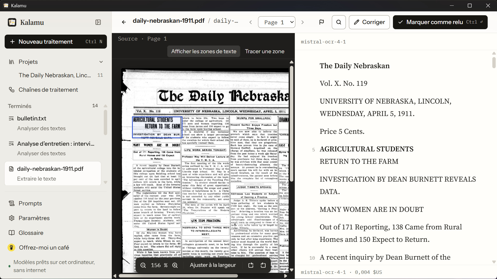
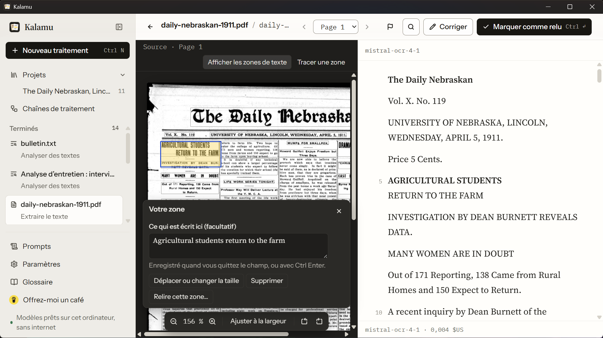

[English](../review.md)

## La relecture, côte à côte

Ouvrez n’importe quel traitement pour le relire. La source est à gauche : le scan sur un fond
sombre, ou le lecteur pour un enregistrement. Le texte est à droite.

- **Passez d’une page à l’autre** avec <kbd>Pg suiv</kbd> et <kbd>Pg préc</kbd>, ou avec la
  liste des pages.
- **Zoomez** sur le scan autour du pointeur, et faites-le glisser pour le déplacer. Une touche
  suffit pour remettre la page à la largeur du volet.
- **Cherchez** dans tout le document avec <kbd>Ctrl</kbd> <kbd>F</kbd> (<kbd>⌘</kbd> <kbd>F</kbd>
  sur un Mac).
- Quand le modèle a situé son texte sur la page (Tesseract, Mistral OCR, LightOnOCR), vous
  pouvez afficher les zones sur le scan et en choisir une pour retrouver ses mots dans le texte.
- Un titre qu’un modèle a écrit comme un titre Markdown (Mistral OCR écrit « # The Daily
  Nebraskan ») s’affiche en gras sans son `#` ; le texte et les fichiers gardent ces marques.

Tous les raccourcis sont listés dans le **Glossaire**, sous *Clavier*, tels qu’ils s’écrivent
sur votre système.

## Corriger le texte

Corrigez le texte directement, puis cliquez sur **Enregistrer la correction** (<kbd>Ctrl</kbd> <kbd>Entrée</kbd>,
<kbd>⌘</kbd> <kbd>Entrée</kbd> sur un Mac), ce qui marque aussi la page comme relue ; **Abandonner les
modifications** la laisse telle qu’elle était. Les deux restent au pied du texte pendant que
vous le faites défiler, quelle que soit la longueur de la page. Trois choses en découlent :

- le texte du modèle est **gardé tel quel** en dessous, et vous pouvez toujours le revoir ;
- les exports utilisent votre texte corrigé et indiquent qu’il a été corrigé ;
- tout ce qui a été tiré de ce texte (une analyse, une traduction) sait si vous l’avez corrigé
  après coup, et le signale.

Une correction non enregistrée n’est jamais perdue sans que vous l’ayez voulu. Changer de page,
quitter la relecture, fermer la fenêtre ou quitter Kalamu demande d’abord s’il faut l’abandonner :
**Abandonner les modifications** continue, **Continuer à modifier** garde votre correction. Sur
un Mac, le bouton rouge ne fait que masquer la fenêtre : il ne demande rien ; <kbd>⌘</kbd>
<kbd>Q</kbd>, si.

**Marquer comme relu** indique à Kalamu, et plus tard à vous-même, qu’une page a été vérifiée
par une personne. Un projet compte les pages relues, et sa liste de
[ce qu’il faut vérifier](projects.md#ce-quil-faut-verifier) s’appuie sur elles.

## Comparer des modèles {#comparer-des-modeles}

Pour repérer rapidement les erreurs, faites lire les mêmes pages par deux modèles et
concentrez-vous sur leurs divergences. Quand deux lectures indépendantes concordent, elles sont
en général justes ; quand elles diffèrent, l’une des deux au moins se trompe.

1. Dans **Nouveau traitement**, choisissez **Comparer avec un autre modèle** et ajoutez un
   second modèle (d’un autre fournisseur si possible : leurs erreurs se ressemblent moins).
2. Dans la relecture, les différences sont surlignées. Pointez-en une pour voir la lecture de
   chaque modèle ; choisissez la bonne avec **Mettre dans le texte**, ou tapez la vôtre.
3. Passez d’une différence à la suivante au clavier, page après page.

Avec **Comparer**, le texte de l’autre modèle s’ouvre à côté du vôtre, sous le titre **Texte
comparé**. Un clic droit dedans (ou la touche menu) permet de **Copier** les mots sélectionnés,
de **Copier tout le texte comparé** et, sur une différence surlignée, de **Mettre dans le
texte** ou d’**Afficher les versions à cet endroit**.

Une fois quelques pages corrigées, Kalamu affiche aussi le **taux d’erreur** de chaque modèle
par rapport à votre texte corrigé. C’est une base honnête pour choisir le modèle du reste de la
collection : il est mesuré sur vos documents, pas sur le banc d’essai de quelqu’un d’autre.

> **Une mise en garde.** Deux modèles peuvent faire la même erreur, surtout sur un mot effacé
> ou un nom peu courant. Leur accord diminue le risque ; il ne remplace pas la lecture de
> quelques pages par vous-même.

## Vérifier une analyse {#verifier-une-analyse}

Une analyse se relit champ par champ, à côté de son document. Corrigez une réponse ; pour une
liste de noms, renommez ou retirez un nom depuis son menu (un clic, <kbd>Entrée</kbd>, ou un
clic droit sur le nom). Chaque réponse s’accompagne de la justification du modèle : elle vous
aide à juger, mais ce n’est pas une preuve. Revenez au texte.

Pour ajouter un nom, un mot-clé ou un thème que le modèle a oublié, utilisez **Ajouter** au bout
de la liste. Ce que vous ajoutez ou renommez est souligné pour montrer que cela vient de vous,
et passe dans les exports, le dictionnaire et la recherche.

Dans l’analyse d’un entretien, chaque citation reprend les mots mêmes de la transcription :
Kalamu cherche chacune dans le texte et laisse de côté celles qu’il ne retrouve pas. Pour
ajouter une citation que le modèle a manquée, sélectionnez le passage dans la transcription,
faites un clic droit et choisissez **Ajouter comme citation**, puis le thème où elle va. Elle
est marquée comme ajoutée par vous, à l’écran et dans tous les exports. Un entretien très long
est lu en plusieurs morceaux, puis le tout est rassemblé : si un morceau n’a pas pu être lu,
l’écran dit quelles minutes manquent et propose **Le relire**.

## Vos propres zones sur un scan

Avec **Afficher les zones de texte** (ou **Afficher les zones**, sur une page où le modèle n’en
a placé aucune), vous pouvez aussi marquer vous-même des parties de la page, pour noter ce qui
s’y trouve ou les faire relire. Rien de tout cela n’apparaît tant que les zones ne sont pas
affichées.

- **Tracer une zone**, puis faites glisser sur la page pour tracer un cadre. Un second appui
  place un cadre au milieu de la page, que les flèches déplacent ; <kbd>Échap</kbd> annule.
- **Déplacer ou changer la taille** d’un cadre en le faisant glisser, ou ses coins et ses côtés.
  Au clavier, les flèches le déplacent, avec <kbd>Maj</kbd> elles changent sa taille,
  <kbd>Entrée</kbd> enregistre.
- Saisissez si vous le voulez **Ce qui est écrit ici**, ou **Supprimer** la zone.
- Un clic droit sur une zone, ou la touche menu ou <kbd>Maj</kbd>+<kbd>F10</kbd> sur elle,
  propose ce qu’offre son panneau et **Copier son texte**.
- Quand le panneau cache ce que vous lisez, faites-le glisser vers le haut ou le bas par sa
  poignée (**Déplacer ce panneau**) ou ses parties vides ; depuis la poignée, les flèches le
  déplacent, et un double-clic le remet en place.
- Un cadre tracé par le modèle peut lui aussi être déplacé ou redimensionné. Son propre cadre
  est conservé, et **Remettre le cadre du modèle** le rétablit.

*Afficher les zones de texte : les blocs trouvés par le modèle, et une zone à vous sur un titre.*

*Une zone à vous, avec sa fiche : ce qui y est écrit, la déplacer, la supprimer ou la faire relire.*

**Relire cette zone…** découpe cette partie de la page dans l’original et l’envoie seule, sous
forme d’image, au modèle que vous choisissez ; rien d’autre du document n’est envoyé. Kalamu
indique d’abord ce que cela devrait coûter, ou que c’est gratuit avec un modèle sur votre
ordinateur. La réponse est une proposition : **En faire le texte de cette zone**, **Remplacer
ces mots dans le texte de la page**, **Modifier d’abord**, ou **Écarter**. Les exports ALTO,
PAGE XML et PDF interrogeable reprennent vos zones.

## Faire corriger un passage par un modèle

Quand quelques lignes sont mal lues et que le reste est bon, sélectionnez-les dans le texte et
faites un clic droit (ou utilisez **Corriger avec un modèle…**, qui apparaît dès qu’il y a une
sélection). Choisissez un modèle et un prompt de correction : **Document manuscrit** est
proposé d’abord pour une page lue avec le prompt des manuscrits, **Document imprimé ou
journal** sinon. Kalamu vous dit ce qui sera envoyé
(le passage et un peu du texte qui l’entoure) et ce que cela devrait coûter. La réponse du
modèle est une proposition, montrée face à votre sélection : acceptez-la, modifiez-la d’abord,
ou écartez-la. L’accepter l’enregistre comme votre correction, que vous pouvez annuler ; rien ne
change tout seul.

## Ce qui peut mal tourner, et comment Kalamu vous le dit

- **Une page a échoué** (le fournisseur l’a refusée, ou la connexion a été coupée) : elle est
  signalée, et relancer le traitement ne refait que les pages en échec.
- **Une réponse a été tronquée** parce qu’elle a atteint la longueur maximale que le modèle peut
  écrire : la page l’indique. Envoyez moins de pages à la fois, ou prenez un modèle qui écrit
  des réponses plus longues.
- **Un modèle a écrit un texte qui n’est pas sur la page.** Rien ne peut le repérer
  automatiquement, et c’est justement pour cela que la relecture existe. Les petits modèles hors
  ligne le font plus souvent que les grands modèles en ligne.
- **Un contenu inapproprié** peut être signalé depuis la relecture.
