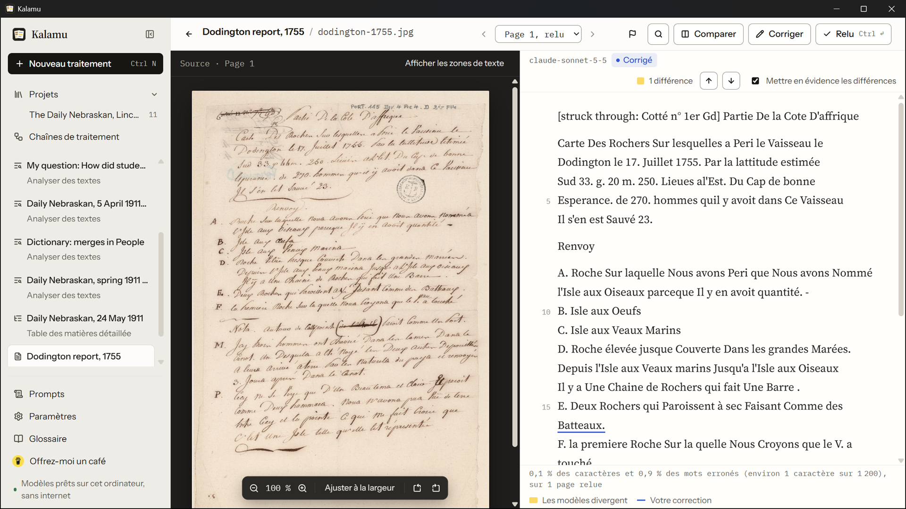
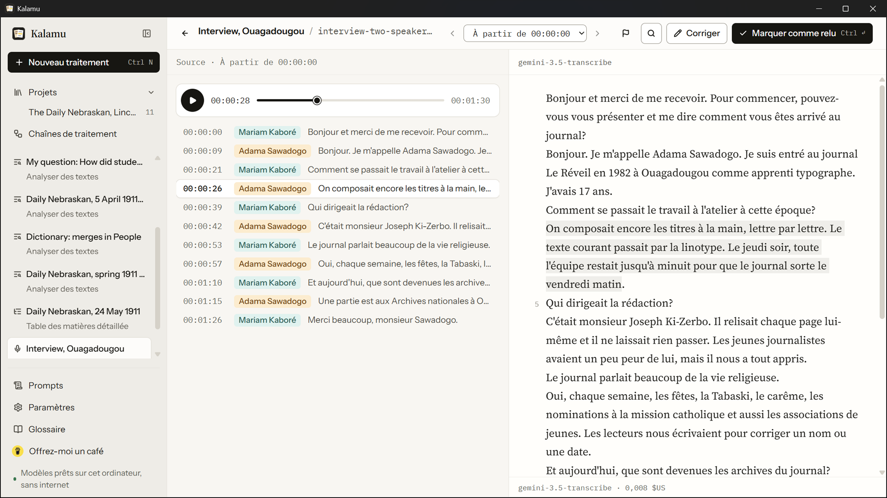
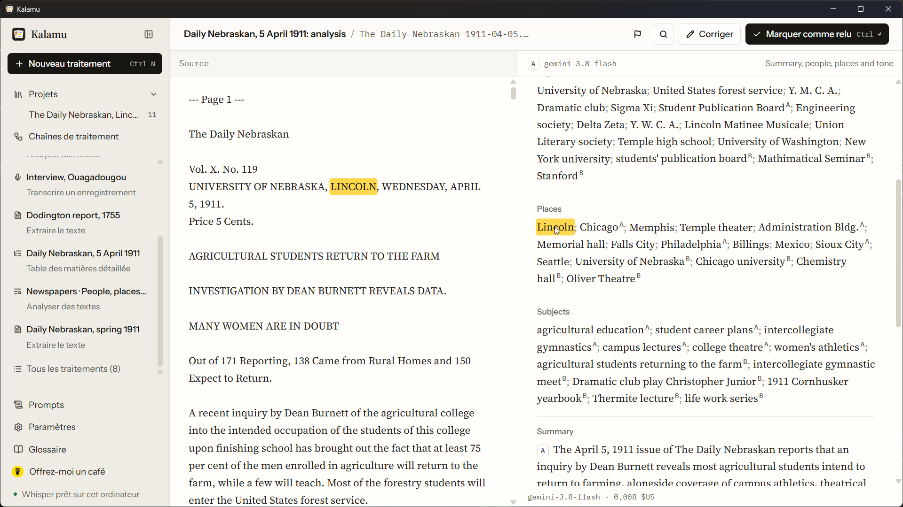
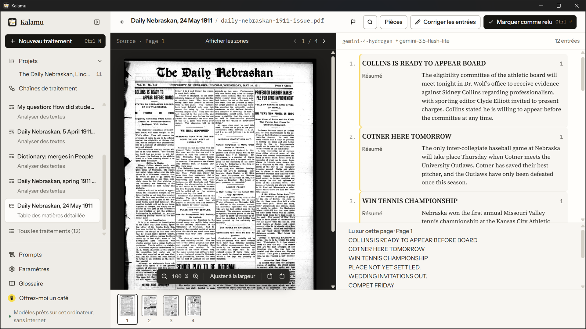
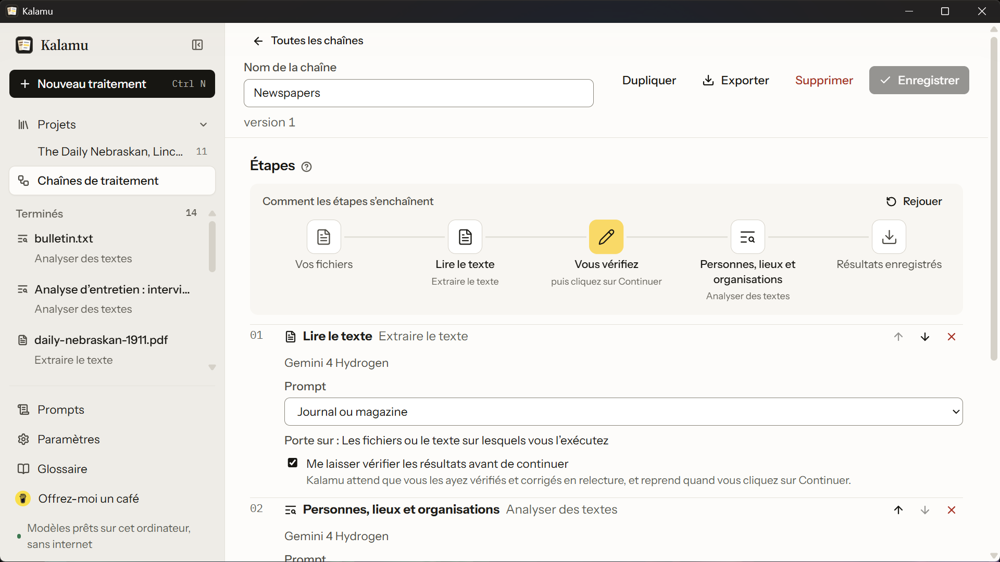

[English](../tasks.md)

## Extraire le texte

Pour les documents imprimés et manuscrits, en PDF ou en images. Les lignes peuvent être gardées
comme sur la page ou réunies en un texte continu. Les pages sont lues une par une ou plusieurs à
la fois, et toujours relues page par page.

Hors ligne, **Tesseract** lit gratuitement l’imprimé net et donne à chaque mot sa place sur la
page. Pour l’imprimé abîmé, les vieux journaux en colonnes et les tableaux, deux petits modèles
de vision faits pour l’OCR fonctionnent aussi hors ligne. Voir
[Travailler hors ligne](offline.md).

*Une écriture manuscrite, lue par un modèle en ligne et vérifiée face à la page.*

## Transcrire un enregistrement ou une vidéo

**Transcrire un enregistrement** prend les enregistrements et les fichiers vidéo de votre
ordinateur (MP3, M4A, WAV, MP4) et rend le texte avec les locuteurs et l’horodatage. La
transcription se fait en ligne, ou hors ligne avec Whisper, qui saute les silences et la
musique. Pendant la relecture, le lecteur suit le texte : choisissez une ligne pour l’écouter.
Vous pouvez donner leur vrai nom aux locuteurs, une seule fois pour tout l’enregistrement.

**Transcrire une vidéo YouTube** prend les liens de vidéos publiques et les transcrit avec
Gemini. Rien n’est téléchargé sur votre ordinateur.

*Une transcription : les locuteurs, l’horodatage, et l’enregistrement à écouter pendant la vérification.*

## Analyser des textes

Une analyse pose les mêmes questions à chaque document et range les réponses dans des champs que
vous définissez : un résumé, les personnes, lieux et organisations cités, la tonalité avec sa
justification, des thèmes tirés de votre propre liste. Elle lit les fichiers texte, les fichiers
Word, les PDF et les résultats de traitements précédents.

Des analyses toutes prêtes répondent aux besoins courants, par exemple :

- un résumé avec des mots-clés ;
- les personnes, les lieux et les organisations ;
- la question, l’argument, les méthodes et les résultats d’une publication scientifique, pour un
  état de l’art ;
- **Description d’image et mots-clés**, pour les photographies, affiches, cartes et autres images
  avec peu ou pas de texte : ce qu’on y voit, le type d’image, et des mots-clés.

Dans **Prompts**, l’éditeur de champs vous permet d’écrire les vôtres : nommez chaque champ,
indiquez le type de réponse attendu (un texte, une liste, un choix dans votre propre liste) et
décrivez ce que vous voulez.

*Une analyse, champ par champ, avec le document dont elle est tirée.*

### Un entretien

Un entretien s’analyse à partir de sa transcription. Dans la relecture de la transcription,
choisissez **Utiliser ce texte dans un nouveau traitement**, puis **Analyser cet entretien**.
Une seule case demande **Sur quoi porte votre recherche ?** : une phrase ou deux aident le
modèle à retenir ce qui compte pour votre travail, et vous pouvez la laisser vide. Cochez
**Garder ce texte pour mes prochains entretiens** pour le retrouver la fois suivante. Le modèle
et le coût estimé tiennent sur une ligne ; cliquez sur **Analyser**. Fermée sans lancer
l’analyse (avec **Annuler** ou <kbd>Échap</kbd>), la fenêtre garde ce que vous avez écrit
jusqu’à sa prochaine ouverture, tant que Kalamu reste ouvert.

Sous **Plus de choix**, vous pouvez changer de modèle et saisir **Vos propres thèmes ou votre
guide d’entretien**, un thème par ligne. Chaque thème de la réponse dit alors s’il vient de
votre liste ou de l’entretien, et un thème de votre liste que l’entretien n’aborde pas est
signalé comme absent, plutôt qu’appuyé sur des citations faibles. Un entretien trop long pour
être lu d’un coup par le modèle est lu en plusieurs morceaux, puis le tout est rassemblé ;
Kalamu l’indique à côté du coût.

La réponse donne un résumé, des thèmes, des mots-clés et les passages à citer, chacun avec qui
parle et à quel moment : [Vérifier une analyse](review.md#verifier-une-analyse) explique comment
la vérifier. À côté de la transcription, Kalamu écrit une note en Markdown (chaque citation avec
qui parle et à quel moment), un fichier JSON et deux tableaux : la réponse dans `.analysis.csv`
et `.analysis.quotations.csv`, une ligne par citation, avec une colonne qui dit si vous l’avez
ajoutée. Les formats choisis dans les Paramètres sont écrits aussi.

### Un registre ou un annuaire en tableau

Une analyse réglée sur *Une ligne par entrée* lit chaque page d’un annuaire, d’un registre ou
d’une liste et en fait une ligne par entrée, dans les colonnes que vous définissez (nom, métier,
adresse ; ou date, nom, lieu). Vous vérifiez et corrigez chaque ligne à côté de sa page, et vous
exportez un seul tableau.

## Table des matières détaillée

Pour un long document numérisé d’un seul tenant : un numéro de journal ou de magazine, un
dossier d’archives, un livre ou un rapport. Un modèle lit chaque page ; un second, moins cher,
rassemble les pages en une entrée par article ou par pièce, avec ses pages, ses auteurs, sa date
ou un résumé. Chaque entrée peut ensuite devenir une pièce à part entière, dont les pages sont
extraites, analysées ou exportées séparément du reste.

*Un numéro de journal, une entrée par article avec ses pages.*

## Corriger un texte existant

Pour un texte déjà mal lu par une machine : la couche texte d’un PDF, ou un fichier texte venu
d’une bibliothèque numérique. Un modèle le corrige page par page en gardant l’orthographe et la
formulation de l’époque, et chaque modification est montrée face à l’original : vous l’acceptez
en connaissance de cause.

## Traduire un texte

Un fichier texte, la couche texte d’un PDF, ou le texte d’un traitement précédent tel que vous
l’avez corrigé, traduit dans la langue de votre choix, page par page, sans rien résumer ni
omettre, et en gardant les noms tels qu’ils sont écrits. La relecture montre la traduction à
côté du texte.

## Un traitement après l’autre

Tout texte que vous avez vérifié peut passer directement dans un nouveau traitement avec
**Utiliser ce texte dans un nouveau traitement** : l’analyser, le corriger ou le traduire, sans
relire les fichiers.

Quand vous refaites souvent la même suite d’opérations, enregistrez-la :

- une **configuration**, ce sont les réglages d’un traitement (tâche, modèle, prompt, options)
  enregistrés sous un nom, pour lancer le lot suivant en un clic, et à exporter pour la partie
  méthodologique d’un article ;
- une **chaîne de traitement** fait passer plusieurs configurations l’une après l’autre sur un
  dossier ou sur une sélection de documents d’un projet, et s’arrête là où vous avez demandé à
  vérifier le texte d’abord. Chaque étape est un traitement à part entière, et relancer une
  chaîne ne fait payer que les étapes qui ont changé.

*Une chaîne de traitement : extraire, vérifier, puis analyser.*
