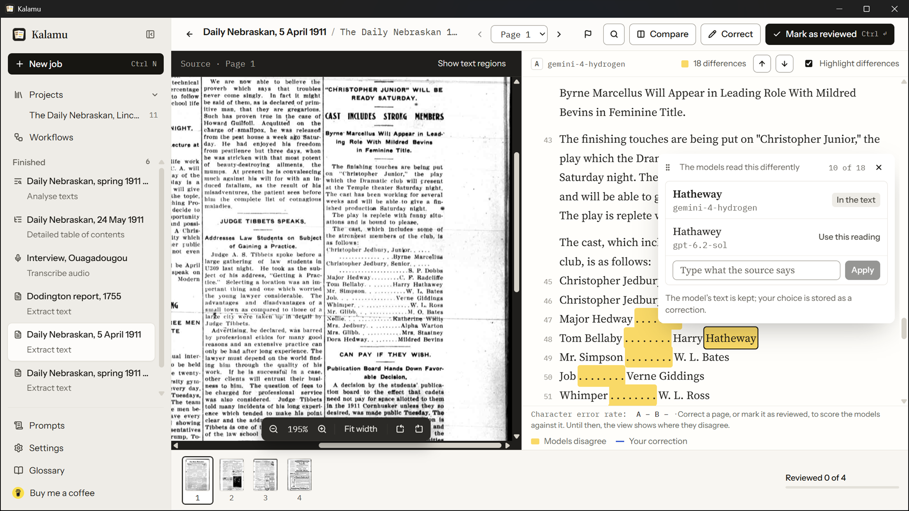

[Français](fr/index.md)

This guide takes you from installing Kalamu to exporting results you have checked. Each chapter
stands on its own; if you are new, read this one, then [Your first job](first-job.md).

*The review: the source on the left, the text beside it, and what two models read differently in yellow.*

## What you need

- **A computer**: Windows 11 (Intel, AMD or Snapdragon) or a Mac with Apple Silicon and macOS 14
  or later.
- **One of two things to do the reading**:
  - an **API key** from Google (Gemini), OpenAI, Anthropic (Claude) or Mistral. You pay the
    provider for what you use, usually a few cents for a first job. Kalamu itself is free and
    takes nothing; or
  - an **offline model**, downloaded once inside the app: Whisper for recordings, Tesseract for
    clean print, small vision and language models for harder pages and for analyses. Nothing is
    sent and nothing is billed, but they are slower and weaker than the cloud models. See
    [Working offline](offline.md).

If your university runs models for its members, or a computer in your office runs Ollama,
Kalamu can use those too: see [Other servers](other-servers.md).

You do not need Python, the command line, or a Kalamu account.

## Install

**Windows.** Install Kalamu from the
[Microsoft Store](https://apps.microsoft.com/detail/9MXT5555BZ1H), which keeps it up to date.
Or download the installer from the
[releases page](https://github.com/fmadore/Kalamu/releases): `Kalamu_<version>_x64-setup.exe`
for Intel and AMD PCs, `Kalamu_<version>_arm64-setup.exe` for Snapdragon laptops. These two are
not signed, so Windows SmartScreen warns the first time: choose **More info**, then **Run
anyway**.

**macOS.** Download `Kalamu_<version>_aarch64.dmg` from the
[releases page](https://github.com/fmadore/Kalamu/releases), open it and drag Kalamu to
Applications. The app is signed and notarised by Apple, so macOS opens it after its usual
question about an app from the internet.

## The first launch

The first time Kalamu opens, with no key saved and nothing installed on the computer, it opens
on **Settings** with **Welcome to Kalamu**. It offers two ways to start, and you can add the
other later:

- **Use a model on this computer**: free, with no account, and nothing leaves your computer.
  The model is downloaded once and is slower than an online one. See
  [Working offline](offline.md).
- **Add a key from an online provider**: faster and often more accurate. You open an account
  with the provider, which charges for what you use, and your files are sent to it. See below.

Once either is in place, Kalamu no longer opens on Settings. **Read the guide**, in the welcome,
the Glossary and Settings › About, opens this guide in the language of the interface.

## Add an API key

1. Open **Settings** (<kbd>Ctrl</kbd> <kbd>,</kbd> on Windows, <kbd>⌘</kbd> <kbd>,</kbd> on a
   Mac), then **API keys**.
2. Beside the provider you want, **Get a key** opens the provider's own page, where you create
   the key. Copy it.
3. Paste it into Kalamu, **Save**, then **Test**: Kalamu answers with the number of models the
   key can use.

The key is kept in Windows Credential Manager or the macOS Keychain, never in a file of
Kalamu's, and is sent only to its provider. Your files go straight from your computer to that
provider; they never pass through a server of Kalamu's, because there is none.

> **Which provider?** Any of them reads print and handwriting well. If you have no preference,
> start with the one your institution already has an agreement with, or with Gemini, whose
> smaller models are cheap enough to try freely. You can add several keys and
> [compare models](review.md#compare-models) on your own documents, which tells you more than
> any ranking.

## Find your way around

The sidebar on the left holds everything:

| Where | What it is for |
| --- | --- |
| **New job** | Choose files, a model and a prompt, see the estimated cost, and start. |
| **Projects** | Your documents grouped by research project, with every reading made of them, a search, a dictionary of names and a list of what still needs checking. |
| **Workflows** | Several steps run one after another: read the text, check it, then analyse it. |
| **Jobs** | Every job you ran, to search, sort, rename or delete. |
| **Prompts** | The instructions models are given: the ones Kalamu ships and your own. |
| **Settings** | API keys, offline models, other servers, language and theme. |
| **Glossary** | Plain explanations of the words these tools use, from OCR to hallucination. |

Under these, the sidebar lists your jobs: running, unfinished, waiting for you to check, and
finished. A job that was paused, or cut short because the app was closed, is offered at the
foot of the sidebar with a **Resume** button.

## Three things to know before you start

- **AI output can be fluent and wrong.** A model can skip a line, modernise a spelling or write
  a name that is not on the page, and it will look just as confident. Kalamu is built around
  checking: always compare a sample with the source before you rely on a result.
- **What the model wrote is never overwritten.** Your corrections are kept beside it, and every
  export records which model, prompt and settings produced the text.
- **You never pay twice for the same work.** Results are saved page by page. A job that stops
  resumes where it was, and asking the same thing again with the same settings costs nothing.
