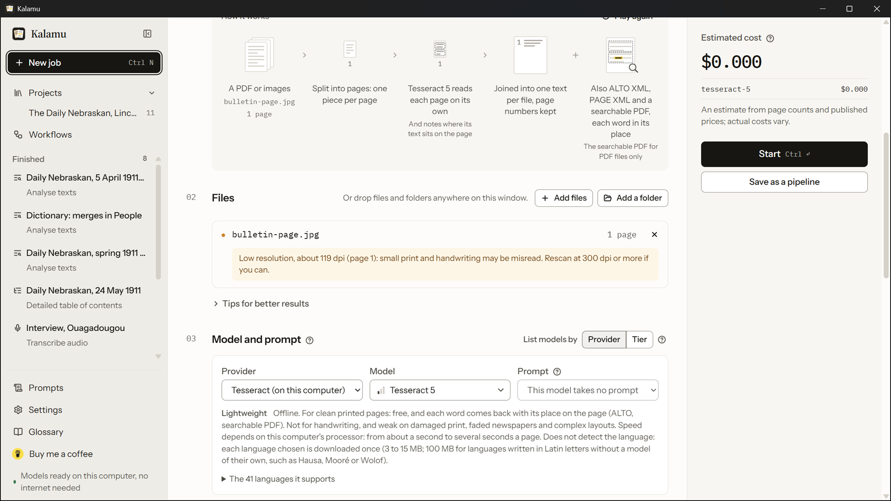

[Français](fr/offline.md)

*Settings › Offline models: download what you need, remove what you do not.*

## What runs offline

| For | Model | What to expect |
| --- | --- | --- |
| Recordings | **Whisper**, in several sizes | Good transcription in many languages. The larger sizes are more accurate and slower. |
| Clean print | **Tesseract** | Fast, free, each word with its place on the page. Language data is downloaded per language. Not for handwriting. |
| Degraded print, columns, tables | **LightOnOCR-3**, **GLM-OCR** | Small vision models. Much better than Tesseract on hard pages, much slower on a processor. Like any language model, they can write text that is not on the page. |
| Search by meaning | **EmbeddingGemma 2** | A small model (310 MB) that prepares a project's text for the [search by meaning and the map](projects.md#search-by-meaning-and-the-map). |
| Analyses, tables of contents, correction | **Gemma 4** (E4B and E2B) | Small language models. Far weaker than the cloud models: check their answers. |

Nothing is sent anywhere and nothing is billed. The price is time, and for the language models,
quality.

## Download a model

Open **Settings**, then **Offline models**. Each model shows its size; **Download** fetches it
once, and an interrupted download continues where it stopped. Kalamu checks every file against
its published fingerprint before using it. Remove a model there when you no longer need it.

Once downloaded, offline models appear in **New job** beside the cloud ones.

## How fast?

It depends on your computer, and above all on its graphics processor.

- **On a Mac with Apple Silicon**, the offline models use the graphics processor (Metal), and
  are at their best.
- **On Windows**, Whisper and the vision and language models use a graphics card through
  Vulkan when the PC has a usable one; otherwise they run on the processor, which is slower,
  sometimes by a lot for the vision and language models.
- Tesseract always runs on the processor and is fast everywhere.

Try one recording or a few pages first to see what your computer manages, then leave a long job
running: it can be paused, and it resumes where it stopped.

## When to prefer the cloud

Handwriting, damaged documents, many speakers, and any analysis that needs judgement are
markedly better with the large cloud models. If your sources allow it, a sensible pattern is
to do the first reading offline where it is good enough (clean print, clear recordings) and
keep the cloud for what needs it. If your sources do not allow it, stay offline and review
more.

Whichever you use, Kalamu records it: an export's `provenance.json` says which model read the
text, cloud or offline.
