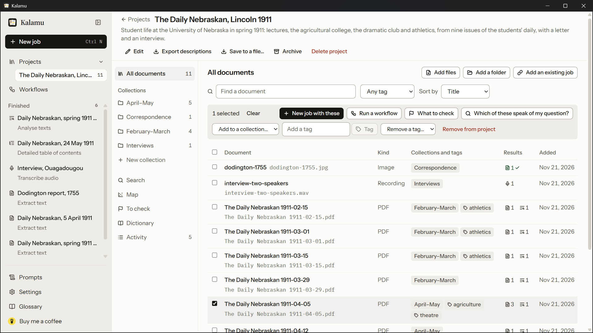
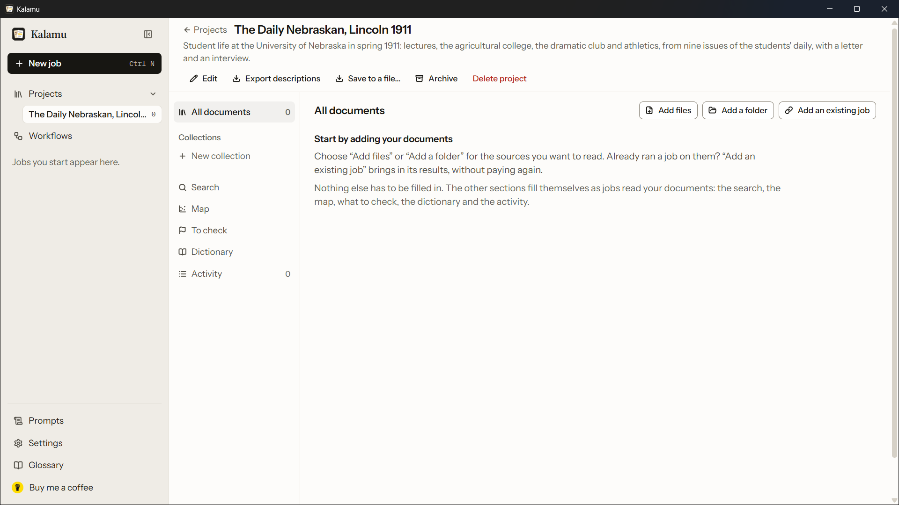
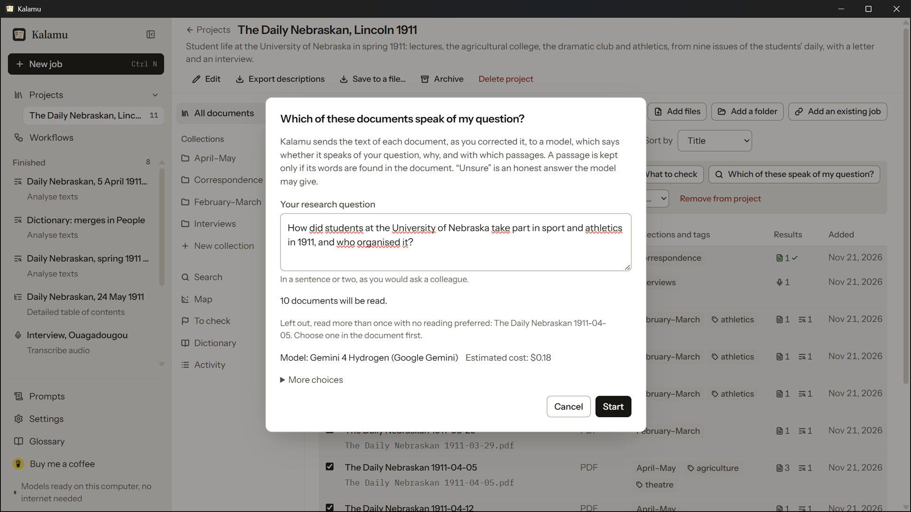
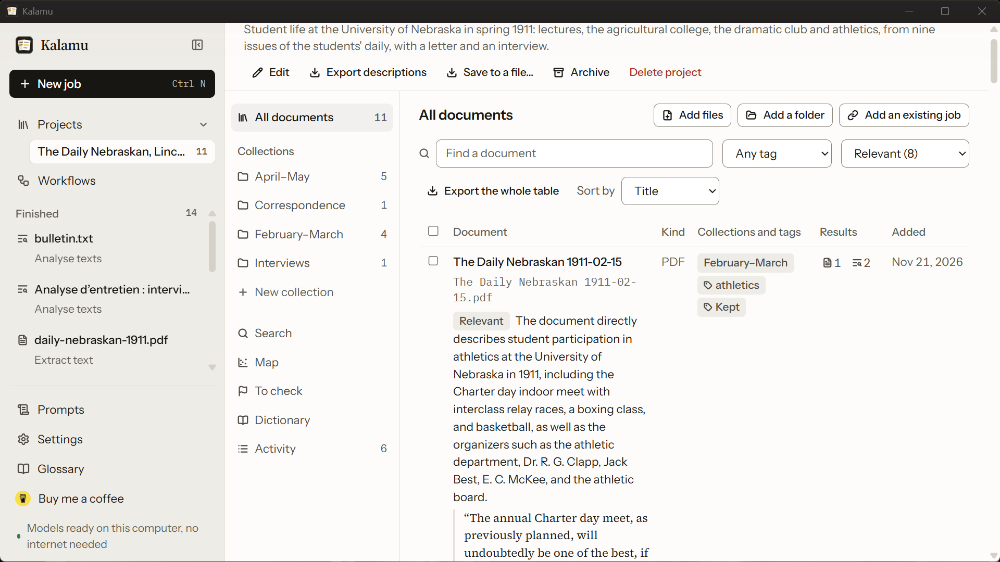
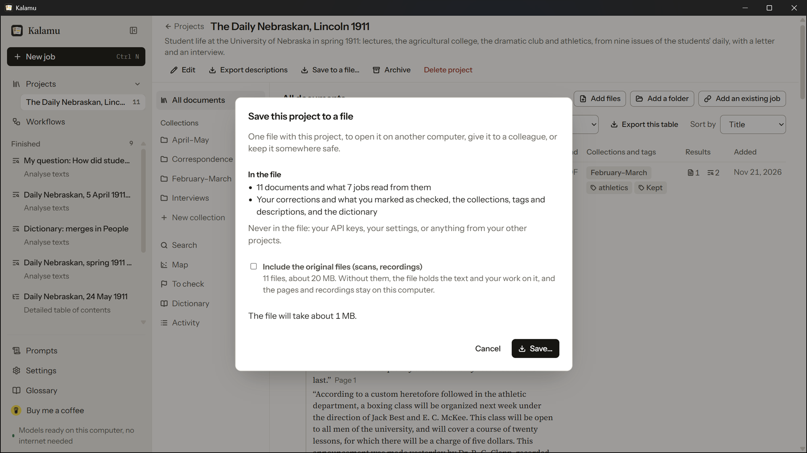
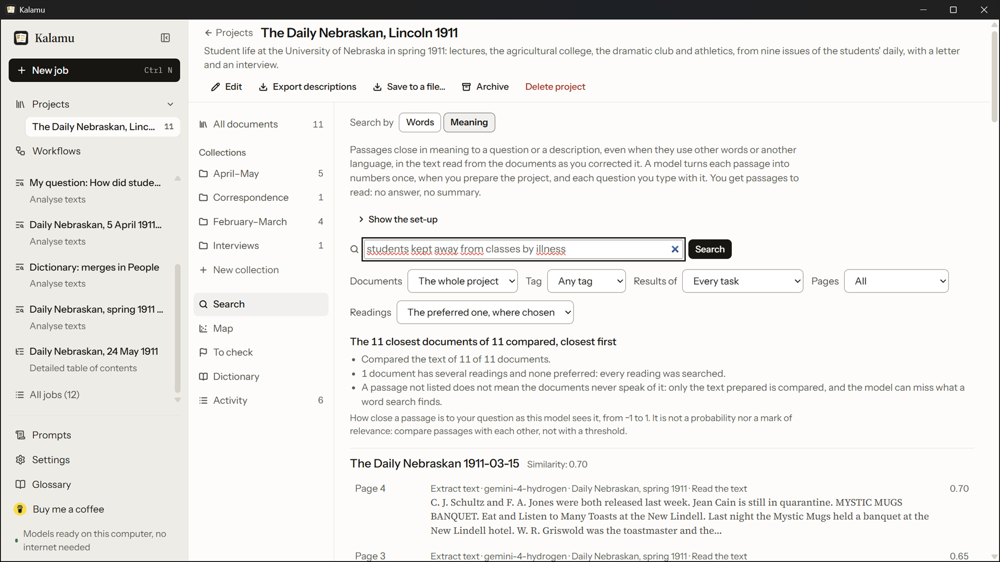
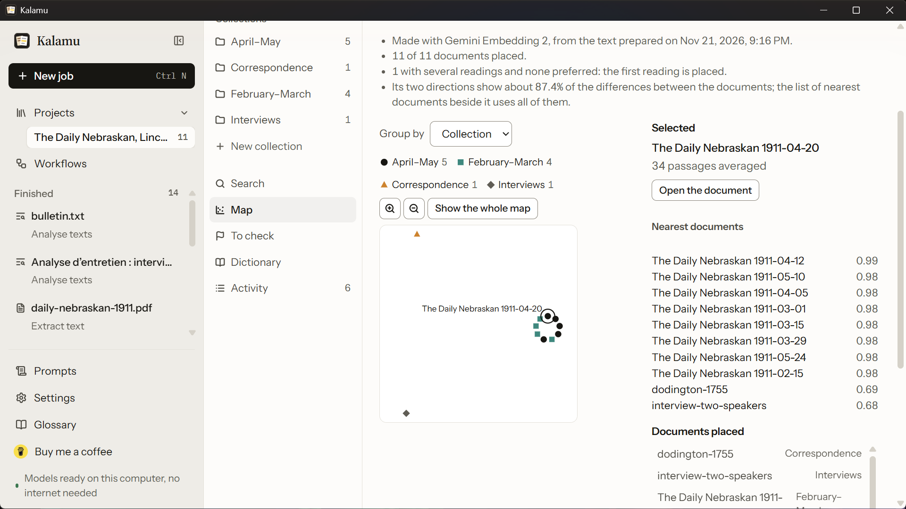
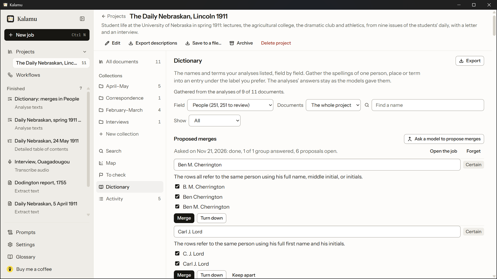

[Français](fr/projects.md)

*A project's documents, each with its extractions, transcriptions and analyses.*

## Documents and collections

A project holds **documents**. A document is a source (a PDF, a folder of photographs, a
recording) with every transcription, extraction and analysis made of it.

*A new project starts by asking for its documents; the other sections fill themselves.*

- **Add files** before reading them, or **add jobs** you already ran: nothing is paid again.
  You can also drag a finished job from the sidebar onto a project.
- Group documents in **collections**; one document can be in several. **Tags** work across
  collections.
- **Start a job on a selection**: tick some documents and run an extraction, an analysis or a
  workflow on them.
- **Ask which documents speak of your question**: select documents that have already been read,
  choose **Which of these speak of my question?**, and type your research question (if you close
  the dialog without starting, Kalamu remembers your question until you reopen it). Each
  document comes back rated as relevant, partly relevant, not relevant, or unsure, with an
  explanation and verbatim passages with page numbers. Filter the table by rating, check the
  passages, and click **Keep** or **Set aside**: your decision is saved as a tag while the
  model's rating stays untouched.

  The tag uses the interface language (*Kept* or *Set aside* in English, *Gardé* or *Écarté* in
  French), and your decision persists if you switch languages in Settings or share the project
  file with a colleague working in the other language. If a document carries both tags, Kalamu
  shows **Kept and set aside: choose one** beside the buttons; clicking either settles it.
  **Export the whole table** writes a spreadsheet whose `job_id` and `prompt_fingerprint`
  columns record which job and prompt version produced each answer. When you add documents
  later, **Read the new documents against this question** screens only the new ones. If you
  edited the prompt since first asking, Kalamu stores the new answers separately and lists both
  runs in the filter with their "first asked" date.
- When a document has been read several times, **mark the result you rely on** as preferred.
  Search, exports and analyses then use that one.

*Which of these speak of my question? The question, how many documents will be read, and what it should cost.*

*The answers in the table: each document's answer, its reason, and the passages found in its text.*

## Save a project to a file

**Save to a file…** writes the whole project as one file ending in `.kalamu`: to open it on a
new computer, to give it to a colleague who shares the checking, or to keep a copy somewhere
safe. The file holds the text read from your documents, your corrections, what you marked as
checked, the tags, the descriptions and the dictionary. It never holds your API keys. Your
scans and recordings are left out unless you tick **Include the original files**; Kalamu
shows how large the file will be before it writes it.

*What goes into a project file, and what never does.*

Before the file is finished, Kalamu checks each file it puts in against the fingerprint taken
when it was read. When an analysis, a translation or a correction read the corrected text of
an earlier result, Kalamu kept that text as it was then; if one of these texts is no longer in
Kalamu's data folder, or has changed since, the save stops and says which document and which
job it concerns. Nothing is written in that case: a file you saved earlier under the same name
stays as it was. An original file that cannot be found, or has changed, is simply left out, and
the dialog says how many. Once the file is written, and before it takes its name, Kalamu reads
it back and checks it, as **Check a project file…** does: the save ends with "The project is
saved in … and checked: everything in it can be opened." A file that does not check is not
kept, the save says it could not be written, and a file you saved earlier under the same name
stays as it was.

### Check a project file

Before you rely on a project file as your only copy, or before you move to a new computer,
choose **Check a project file…** in the list of projects, then the file. Kalamu reads it on
your computer, without opening it as a project: nothing is sent, nothing is changed, and no
project is added. It first gives a short verdict, such as "This file is whole: everything in it
can be opened.", then says:

- which version of Kalamu saved it, and how many documents and jobs it holds;
- whether every corrected text the jobs read is in it and intact; a file saved by Kalamu 1.10.0
  may lack one, and the check names it with the jobs that read it;
- how many original files are in it and intact, whether it was saved without them, and how many
  could not be put in it;
- which documents will show as **File missing** on another computer, because their files are
  not in it;
- which original files would take another name on this computer, because the system does not
  accept their name as it is or another file already has it.

If a part of the file no longer matches what was saved (a copy cut short, a damaged disk), the
check says "This file is damaged" and names that part: ask for the file again, or save it again.
A file saved by a newer version of Kalamu is refused as when opening it.

On the other computer, Windows or Mac, choose **Open a project file…** in the list of
projects. It opens as a new project beside the others: nothing you already have is changed.
When the file holds the original files, Kalamu copies them into its data folder, in a folder
of the new project's own. **Delete project** removes them with it, and says so before you
confirm; the jobs the file brought keep their results and show those files as missing. Files
you keep elsewhere are never touched.
Anyone who has the file can read everything in it, so look after it as you do the documents.
A file saved by Kalamu 1.10.0 may lack one of these corrected texts: it still opens, and the
message shown after opening names each text missing and the jobs that read it. Their results
are kept, but the text they read is not there.

## Describe your sources

Each document can be described as an archive would describe it: repository, fonds, shelfmark,
creator, date, citation, rights. What all the documents of a project share is given once for
the project. **Export descriptions** writes them as three files under the name you choose: a
JSON file (`name.json`), a spreadsheet for Excel (`name.xlsx`) and a CSV (`name.csv`), in
Kalamu's columns or in columns of your own that you can save for the next project, beside each
document's corrected text, review status or analysis answers.

Only the JSON file's name is asked about. If a spreadsheet or a CSV of yours already has that
name in the folder, Kalamu leaves it as it is, writes the table as `name (2).xlsx` and
`name (2).csv`, and tells you so. Files from an earlier export of Kalamu that you have not
changed since are simply replaced. **Export the whole table**, **Export the list** and the
dictionary's export keep your files in the same way.

## Search a project

**Search** finds every passage across the project's documents that matches your words in the
text as you corrected it. Capitals, accents, and Arabic diacritics are ignored. Search for words
anywhere on a page or within a few words of one another, and filter by collection, tag, task, or
review state. Clicking any match opens its source at that exact passage. With **Also search
what models wrote about them: analyses and tables of contents** ticked, matches in those answers
are labelled **Written by a model**, and entries you added yourself are labelled **Written by
you**.

Search runs locally on your computer and sends nothing. Alongside every search, Kalamu reports
what was searched and what was not (unread documents, failed pages), so an empty result is never
mistaken for absence.

## Search by meaning, and the map

Keyword search finds exact wording. **Meaning** finds passages that discuss your topic in
different words: searching for *disputes over land* can surface a passage about *the quarrel
about the plot beside the market*.

Because it relies on numerical representations (embeddings) computed from your text, you prepare
a project once:

1. In the project's **Search**, choose **Meaning** and select a model. EmbeddingGemma 2 runs
   locally after a one-time download in **Settings › Offline models**, sending nothing and
   costing nothing. Gemini, OpenAI, and Mistral are faster and inexpensive; before sending
   anything, Kalamu asks for confirmation and explains that the corrected text of your project's
   documents (and each search query you type afterwards) will be sent to that provider.
2. Kalamu displays an estimated preparation cost upfront. Start preparation; you can pause at
   any time and resume where you stopped.
3. Type a question or description. Documents are ranked by their closest passage regardless of
   length, and clicking any passage opens its source at that spot.

After you correct text, Kalamu says how many pages changed and offers to update them. It never
does so by itself with a paid model.

*A question in your own words finds passages that say it in theirs, each with how close it is.*

The **Map** shows each document of the project as a point, near the documents it resembles,
grouped by collection or tag. Choose a point to see its nearest documents in the list beside
it. Read it as a way in, not as a result: positions are approximate, the axes mean nothing,
and a long document's point is an average of everything in it. Documents that sit almost on
one another are drawn a little apart, in a small ring; zoom in to see them at their own places.

*The map: a document chosen, and the documents nearest to it.*

> There are no answers and no chat. The search by meaning shows you where to read; the reading
> stays yours.

## The dictionary

The people, places, organisations and terms your analyses listed are gathered in the project's
**Dictionary**. The same person is often spelled several ways (a transliteration, initials,
surname first); the dictionary lets you gather those spellings into one entry under the label
you choose.

*The dictionary: spellings gathered into entries, with merges a model proposed.*

- You can merge entries by hand, or ask a model to **propose merges**. A proposal is only ever
  a proposal: you accept it, change it or turn it down, and two names you decided to keep
  apart are not proposed again.
- Exports can give analysis answers as the model wrote them or under your dictionary's labels.
- A new analysis can be given the names already in the dictionary, so it spells them your way.

## What to check

**What to check** is one list, across the whole project, of the pages and answers that need
you: those that failed or were cut off, those two models read differently, analyses read from
a text you corrected since, and what is not yet reviewed. Each line opens its review at the
right page, on the model's reading it names: in a comparison, that reading is the one shown
first, which you correct and mark as reviewed, the others compared with it. Nothing is sent to
a model to build it.

For a large project that cannot be reviewed in full, draw a **random sample** of pages to
review, of a size you choose. The sample is drawn from a seed that Kalamu shows, so a
colleague can draw the same pages, and you can export the list as a record of what was
checked.
