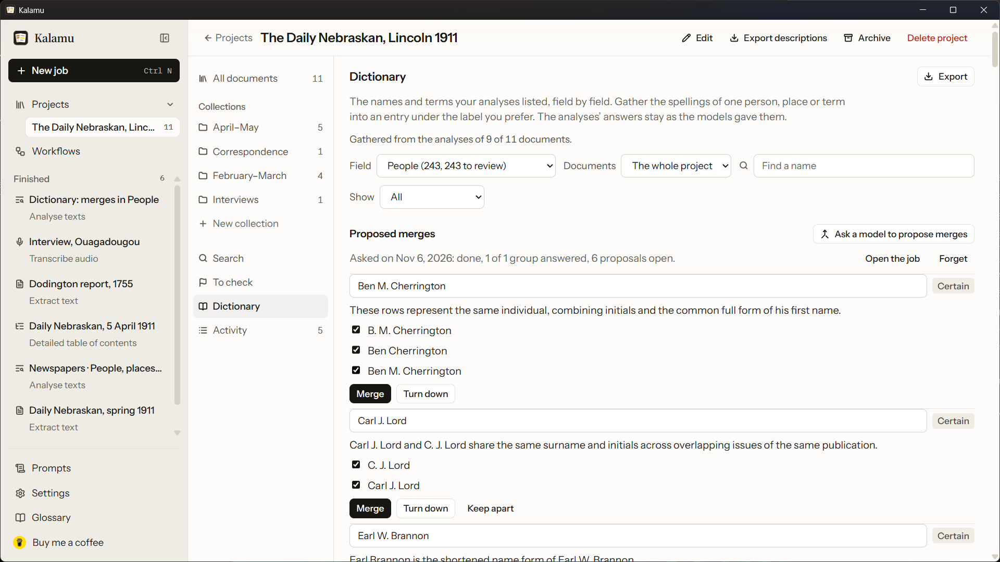

[Français](fr/projects.md)

*A project's documents, each with its extractions, transcriptions and analyses.*

## Documents and collections

A project holds **documents**. A document is a source (a PDF, a folder of photographs, a
recording) with every transcription, extraction and analysis made of it.

- **Add files** before reading them, or **add jobs** you already ran: nothing is paid again.
  You can also drag a finished job from the sidebar onto a project.
- Group documents in **collections**; one document can be in several. **Tags** work across
  collections.
- **Start a job on a selection**: tick some documents and run an extraction, an analysis or a
  workflow on them.
- **Ask which documents speak of your question**: tick some documents that have been read,
  choose **Which of these speak of my question?** and type your research question (closed
  without starting, it keeps your question until you open it again). Each document comes back as relevant, partly relevant, not relevant or unsure, with a reason and
  the passages that show it, each found word for word in the text with its page. Filter the
  table by the answer, read the passages, then **Keep** or **Set aside**: your decision is a
  tag, and the model's answer stays as it was. **Export the whole table** writes the whole list for
  a spreadsheet. With an answer chosen in the filter, each row shows its answer, the reason
  and the passages. When you add documents later, **Read the new documents against this
  question** asks it of those alone.
- When a document has been read several times, **mark the result you rely on** as preferred.
  Search, exports and analyses then use that one.

## Save a project to a file

**Save to a file…** writes the whole project as one file ending in `.kalamu`: to open it on a
new computer, to give it to a colleague who shares the checking, or to keep a copy somewhere
safe. The file holds the text read from your documents, your corrections, what you marked as
checked, the tags, the descriptions and the dictionary. It never holds your API keys. Your
scans and recordings are left out unless you tick **Include the original files**; Kalamu
shows how large the file will be before it writes it.

On the other computer, Windows or Mac, choose **Open a project file…** in the list of
projects. It opens as a new project beside the others: nothing you already have is changed.
Anyone who has the file can read everything in it, so look after it as you do the documents.

## Describe your sources

Each document can be described as an archive would describe it: repository, fonds, shelfmark,
creator, date, citation, rights. What all the documents of a project share is given once for
the project. **Export descriptions** writes them as CSV or JSON, in Kalamu's columns or in
columns of your own that you can save for the next project, beside each document's corrected
text, review status or analysis answers.

## Search a project

**Search** finds every passage of the project's documents that holds your words, in the text as
you corrected it. Capitals, accents and Arabic vowel marks are ignored. You can ask for all the
words anywhere on a page, or within a few words of each other, and narrow the search by
collection, tag, task or review state. Each match opens its source where it stands. With
**Also search what models wrote about them: analyses and tables of contents** ticked, matches in
those answers are marked **Written by a model**, and a name you added to an analysis's list
yourself **Written by you**.

The search runs on your computer; nothing is sent. With every search, Kalamu says what was
searched and what was not (documents not read yet, pages that failed), so that finding nothing
is not mistaken for absence.

## Search by meaning, and the map

The search by words finds what is written. **Meaning** finds passages that speak of what you
describe in other words than yours: a question such as *disputes over land* can
find a passage that says *the quarrel about the plot beside the market*.

It works from numbers that a model works out from your text, so it has to be prepared once:

1. In the project's **Search**, choose **Meaning**, then a model. EmbeddingGemma 2 runs on your
   computer after a download in **Settings › Offline models**: nothing is sent and nothing is
   billed. Gemini, OpenAI and Mistral are faster and cost a little; for those, Kalamu asks
   first, and says that the corrected text of the project's documents will be sent to that
   provider, and afterwards each question you type.
2. Kalamu shows an estimate of what preparing will cost before anything is sent. Start it; you
   can pause it, and it goes on where it stopped.
3. Type a question or a description. Documents are listed by their best passage, whatever
   their length, and each passage opens its source where it stands.

After you correct text, Kalamu says how many pages changed and offers to update them. It never
does so by itself with a paid model.

The **Map** shows each document of the project as a point, near the documents it resembles,
grouped by collection or tag. Choose a point to see its nearest documents in the list beside
it. Read it as a way in, not as a result: positions are approximate, the axes mean nothing,
and a long document's point is an average of everything in it. Documents that sit almost on
one another are drawn a little apart, in a small ring; zoom in to see them at their own places.

> There are no answers and no chat. The search by meaning shows you where to read; the reading
> stays yours.

## The dictionary

The people, places, organisations and terms your analyses listed are gathered in the project's
**Dictionary**. The same person is often spelled several ways (a transliteration, initials,
surname first); the dictionary lets you gather those spellings into one entry under the label
you choose.

*The dictionary: spellings gathered into entries, with merges a model proposed.*

- You can merge entries by hand, or ask a model to **propose merges**. A proposal is only ever
  a proposal: you accept it, change it or turn it down, and two names you decided to keep
  apart are not proposed again.
- Exports can give analysis answers as the model wrote them or under your dictionary's labels.
- A new analysis can be given the names already in the dictionary, so it spells them your way.

## What to check

**What to check** is one list, across the whole project, of the pages and answers that need
you: those that failed or were cut off, those two models read differently, analyses read from
a text you corrected since, and what is not yet reviewed. Each line opens its review at the
right page, on the model's reading it names: in a comparison, that reading is the one shown
first, which you correct and mark as reviewed, the others compared with it. Nothing is sent to
a model to build it.

For a large project that cannot be reviewed in full, draw a **random sample** of pages to
review, of a size you choose. The sample is drawn from a seed that Kalamu shows, so a
colleague can draw the same pages, and you can export the list as a record of what was
checked.
