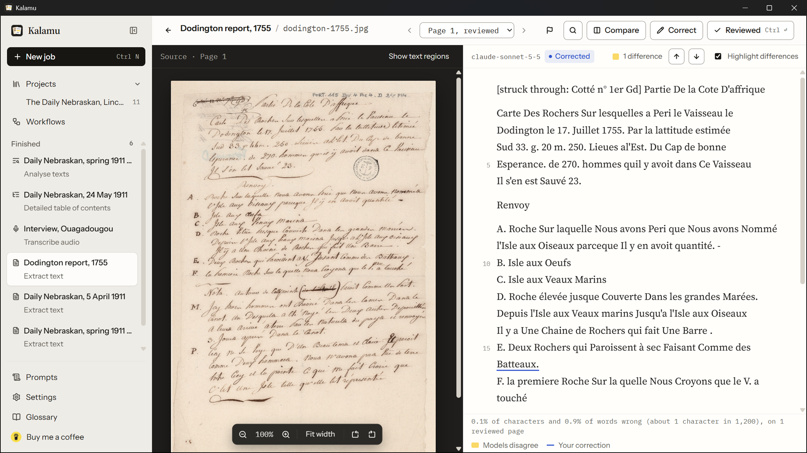
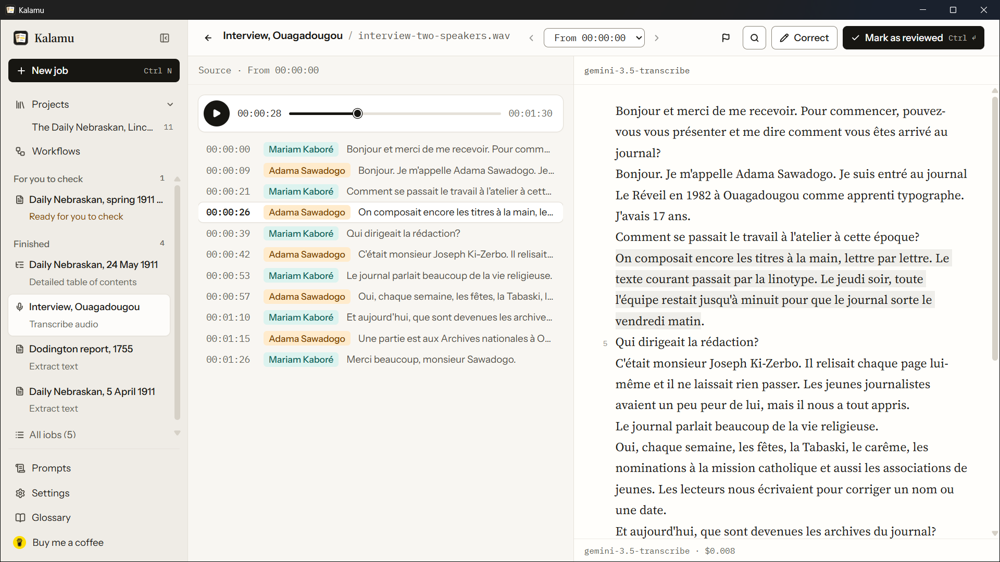
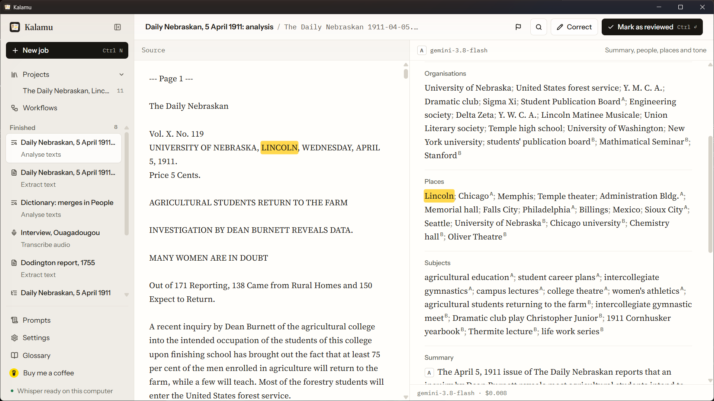
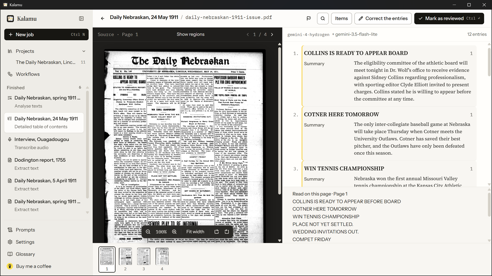
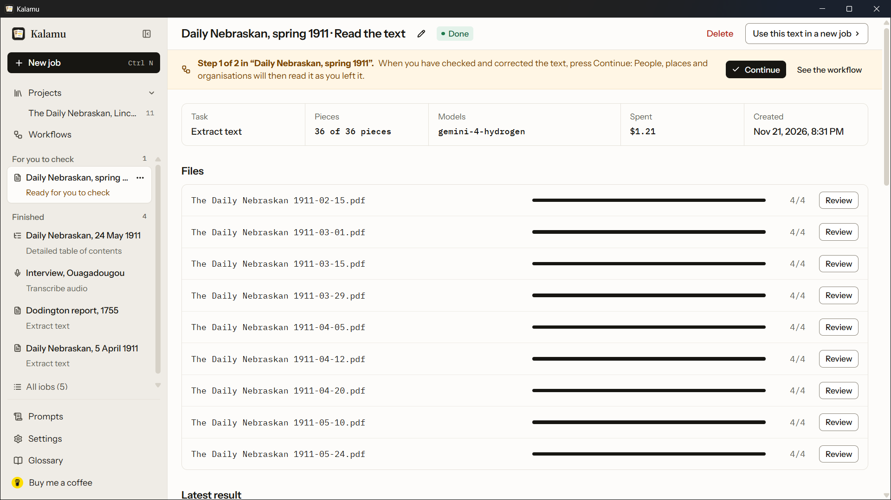

[Français](fr/tasks.md)

## Extract text

For printed and handwritten documents as PDFs or images. Lines can be kept as on the page or
joined into running text. Pages are read one at a time or several together, and always
reviewed page by page.

Offline, **Tesseract** reads clean print for free and gives each word its place on the page.
For degraded print, old newspapers in columns and tables, two small OCR vision models also run
offline. See [Working offline](offline.md).

*Handwriting, read by a cloud model and checked against the page.*

## Transcribe audio and video

**Transcribe audio** takes recordings and video files on your computer (MP3, M4A, WAV, MP4) and
returns the text with speakers and timestamps. In the cloud, or offline with Whisper, which
skips silence and music. In the review, the player follows the text: choose a line to hear it.
Speakers can be given their real names once, for the whole recording.

**Transcribe YouTube** takes the links of public videos and transcribes them with Gemini.
Nothing is downloaded to your computer.

*A transcript: speakers, timestamps, and the recording to listen to while you check.*

## Analyse texts

An analysis asks the same questions of every document and returns the answers in fields you
define: a summary, the people, places and organisations named, the tone with a reason, themes
from your own list. It reads text files, Word files, PDFs, and the results of earlier jobs.

Ready-made analyses cover common needs, among them:

- a summary with keywords;
- people, places and organisations;
- the question, argument, methods and findings of a scholarly publication, for a literature
  review;
- **Image description and keywords**, for photographs, posters, maps and other images with
  little or no text: what is visibly there, the kind of image, and keywords.

Under **Prompts**, the field editor lets you write your own: name each field, say what kind of
answer it takes (a text, a list, a choice from your own list), and describe what you want.

Each text is sent whole, so it must fit in what the model reads at once: about 11,000 words for
the offline Gemma 4 models, far more for the cloud models. A text that does not fit is named
above **Start** in New job, and Start stays off until you choose another model or split the
text, for example: *long-text.txt is too long for Gemma 4 E2B: about 48,000 words, where it
reads about 11,000 at once. Choose another model, or split the text into shorter documents.*
Nothing is sent and no job is made. An interview is read in parts instead (below).

*An analysis, field by field, with the document it was read from.*

### An interview

An interview is analysed from its transcript. In the transcript's review, choose **Use this
text in a new job**, then **Analyse this interview**. One box asks **What is your research
about?**: a sentence or two helps the model pick out what matters to your work, and it may be
left empty. Tick **Keep this for my next interviews** to find it there next time. The model and
the estimated cost are said in one line; press **Analyse**. Closed without analysing (with
**Cancel** or <kbd>Esc</kbd>), the dialog keeps what you typed until you open it again, as long
as Kalamu stays open.

Under **More choices** you can change the model, and type **Your own themes or interview
guide**, one theme per line. Each theme in the answer then says whether it comes from your list
or emerged from the interview, and a theme of yours the interview does not take up is listed as
missing rather than backed with weak quotations. An interview too long for the model to read at
once is read in parts, then brought together; Kalamu says so beside the cost.

The answer gives a summary, themes, keywords and passages worth quoting, each with who speaks
and when: [Check an analysis](review.md#check-an-analysis) says how to check it. Beside the
transcript, Kalamu writes a Markdown memo (each quotation with its speaker and time), a JSON
file, and two tables: the answer's `.analysis.csv` and `.analysis.quotations.csv`, one row per
quotation, with a column saying whether you added it. The formats you chose in Settings are
written as well.

### A register or a directory as a table

An analysis set to *One row per entry* reads each page of a directory, a register or a list
into one row per entry, in the columns you define (surname, trade, address; date, name,
place). You check and correct each row beside its page and export one spreadsheet.

## Make a detailed table of contents

For a long document scanned in one piece: a newspaper or magazine issue, an archival file, a
book or a report. One model reads each page; a second, cheaper one combines the pages into one
entry per article or item, with its pages, authors, date or summary. Each entry can then become
an item of its own, whose pages are extracted, analysed or exported apart from the rest.

*A newspaper issue, one entry per article with its pages.*

## Correct existing text

For text that a machine already read badly: the text layer of a PDF, or a text file from a
digital library. A model corrects it page by page, keeping the spelling and wording of the
time, and every change is shown against the original so you can accept it with open eyes.

## Translate a text

A text file, a PDF's text layer, or the text of an earlier job as you corrected it, put into
the language you choose, page by page, with nothing summarised or left out and names kept as
written. The review shows the translation beside the text.

## One job after another

Any text you have checked can go straight into a new job with **Use this text in a new job**:
analyse it, correct it, or translate it, without reading the files again.

When you repeat the same chain often, save it:

- a **pipeline** is a job's settings (task, model, prompt, options) saved under a name, to
  start the next batch in one click and to export for a methods section;
- a **workflow** runs several pipelines one after another on a folder or on a selection of a
  project's documents, pausing where you asked to check the text first. Each step is a job of
  its own, and running a workflow again pays only for the steps that changed.

*A workflow: extract, check, then analyse.*
